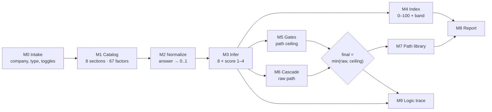
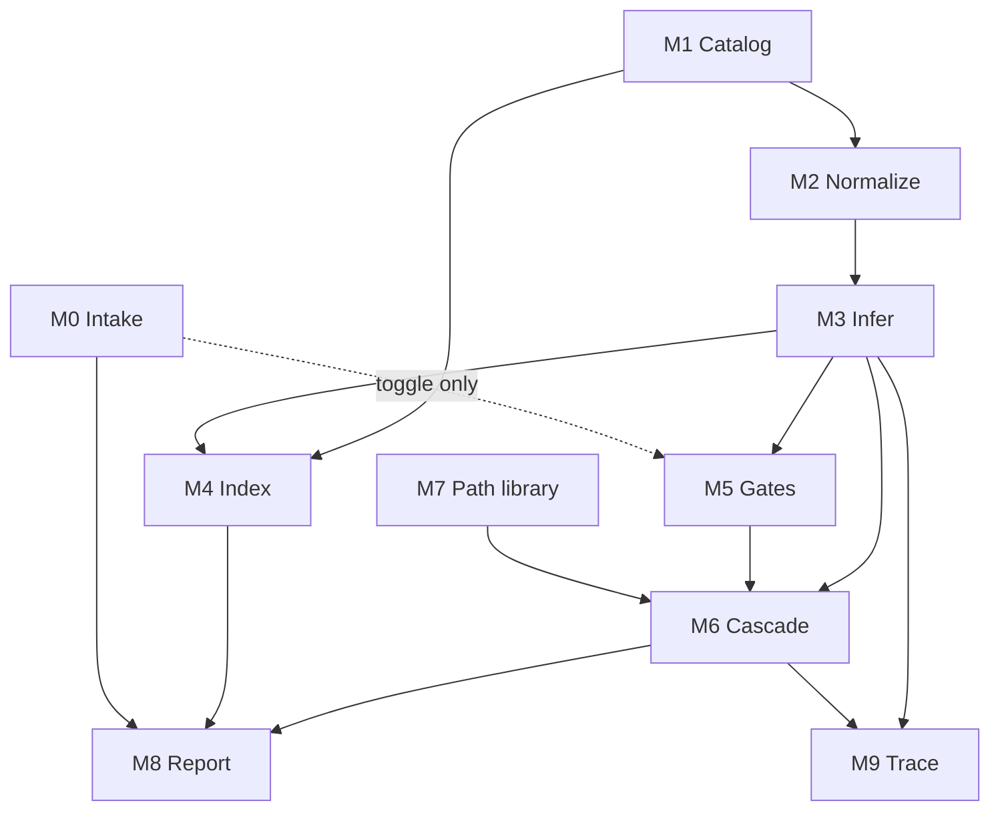

# AI Readiness Assessment: System Deep Dive

**Logic, mechanics, assumptions, and reasoning, organized as modular components**

| | |
|---|---|
| **Version** | 1.0 |
| **Status** | Snapshot of the system *as built*. Known issues are documented, not fixed. |
| **Date** | 2026-10-13 |
| **Code reference** | `a-stretz/framework`, branch `claude/ai-readiness-assessment-design-U7r6s`, commit `8aa65ff` (app code). This document and its analysis harness are committed alongside it under `assessment/docs/`. |
| **Owner** | Austin Stretz |
| **Companion documents** | `AI-Readiness-Executive-Summary-v1.0.md` (plain-language overview) · Framework Reference (single-page HTML outline) · Working prototype |
| **Reproducibility** | Every finding and number below is re-derived by `assessment/docs/analysis/framework-analysis.mjs` (no dependencies; `node assessment/docs/analysis/framework-analysis.mjs`). The v1.0 output is frozen in `analysis/framework-analysis-output-v1.0.txt`. |
| **Next step** | Adapting the framework to BERPL. §24 lists the integration seams. |

---

## Contents

0. [How to read this document](#0-how-to-read-this-document)
1. [What the system is](#1-what-the-system-is)
2. [Design principles](#2-design-principles)
3. [System at a glance](#3-system-at-a-glance)
4. [Module architecture](#4-module-architecture)
5. [M0: Intake & Context](#5-m0--intake--context)
6. [M1: Diagnostic Catalog](#6-m1--diagnostic-catalog)
7. [M2: Factor Normalization](#7-m2--factor-normalization)
8. [M3: Section Score Inference](#8-m3--section-score-inference)
9. [M4: Readiness Index & Bands](#9-m4--readiness-index--bands)
10. [M5: Hard Gating](#10-m5--hard-gating)
11. [M6: Path Selection Cascade](#11-m6--path-selection-cascade)
12. [M7: Path Library](#12-m7--path-library)
13. [M8: Report Composition](#13-m8--report-composition)
14. [M9: Logic Trace & Live Panel](#14-m9--logic-trace--live-panel)
15. [Verified structural findings](#15-verified-structural-findings)
16. [Tunable parameter register](#16-tunable-parameter-register)
17. [Sensitivity analysis](#17-sensitivity-analysis)
18. [Worked example: Meridian Freight Systems](#18-worked-example--meridian-freight-systems)
19. [Known issues & recommended fixes](#19-known-issues--recommended-fixes)
20. [Extension & modification playbook](#20-extension--modification-playbook)
21. [Decision log](#21-decision-log)
22. [Assumptions register](#22-assumptions-register)
23. [Validation & calibration roadmap](#23-validation--calibration-roadmap)
24. [Integration seams (for the BERPL conversion)](#24-integration-seams-for-the-berpl-conversion)
25. [Build, run & deploy reference](#25-build-run--deploy-reference)
- [Appendix A: Full factor catalog](#appendix-a--full-factor-catalog)
- [Appendix B: Path library text](#appendix-b--path-library-text)
- [Appendix C: Glossary](#appendix-c--glossary)

---

## 0. How to read this document

**Who it's for.** A future build, human or AI, starting from zero context. It assumes no memory of the conversations that produced the system. If you are that future build: read §1–4 to orient, §11.3 for the single most important simplification, §15 for what's verifiably true, and §16 before you touch any number.

**Ground-truth rule.** For v1.0, *the code is the truth*. Where this document and the code disagree, the document has a bug. The analysis harness exists so that claims can be re-checked rather than trusted.

**The three-layer model.** The central idea of this document is that every piece of the system belongs to one of three layers. The layer tells you how safely it can be changed:

| Layer | Tag | What it is | Changing it… |
|---|---|---|---|
| **Structure** | `[STRUCTURE]` | The shape of the reasoning: what feeds what, what can override what, what the scales are. | …changes *what the framework is*. Requires redesign, re-validation, and updating this document. |
| **Calibration** | `[CALIBRATION]` | Subjective numbers inside the structure: weights, thresholds, cut points. | …changes *how the framework judges*. Safe within stated constraints. Re-run the harness and compare. |
| **Content** | `[CONTENT]` | Words: labels, questions, helper text, plays, messages. | …changes *how the framework speaks*. No logic impact. Rewrite freely. |

Each calibration parameter also carries a **basis** that says how firmly it's grounded:

| Basis | Meaning |
|---|---|
| **Structural** | Follows from the logic. Another value would be inconsistent. |
| **Judgment** | A reasoned choice with a stated rationale, *not yet calibrated against outcomes*. |
| **Convention** | Arbitrary but reasonable. A nearby value would do equally well. |

> The rationale in this document is the strongest defensible reasoning for each choice. The framework's original design intent and the decisions made during the build are intertwined, and separating them isn't the goal. The goal is that each component's job, assumptions, and dependencies are explicit enough to **adjust, expand, or remove it without breaking the whole**.

---

## 1. What the system is

**Purpose.** A structured diagnostic that converts *observable conditions inside a company* into a *defensible recommendation for the next AI intervention*. It answers "what should this company do next with AI, and why?", not "how good is this company at AI?"

**Primary user.** An **operator**: an AI strategist, portfolio advisor, operating partner, or consultant assessing a company, usually through interviews, document review, and product walkthroughs.

**Unit of analysis.** One company, one assessment session. There's no persistence, multi-company comparison, or history in v1.0.

**Inputs.**
- company metadata and a company type (framing only)
- answers to up to 67 factor questions across 8 diagnostic sections
- optional evidence notes per section
- one logic toggle (hard gating)

**Outputs.**
- eight section scores (1–4)
- a readiness index (0–100) and band
- a recommended intervention path (1–5), its rationale, any gates that capped it, plays, and next actions
- a full logic trace

**Origin context.** Built as a working prototype for assessing software companies in a growth-equity portfolio context (the Five Elms environment). That context explains the four company types: B2B SaaS, vertical software, AI-native, and services + software. The *structure* was designed to be universal across company types, and the next planned step is adapting it to BERPL.

**What it is not.** It's not a maturity benchmark across companies, not a prediction of AI project success, not a talent assessment of the team, and not calibrated against real outcomes yet (§23).

---

## 2. Design principles

These are the reasons the architecture looks the way it does. Each module exists to serve one or more of them. If you change a module, check that you aren't silently abandoning a principle.

| # | Principle | Reasoning | Implemented by | What you lose if you drop it |
|---|---|---|---|---|
| **P1** | **Observe, don't rate.** Operators record conditions; the system infers scores. | Direct self-scoring ("rate leadership 1–4") is anchored by the rater's priors and varies between raters. Observable conditions ("is there a named executive owner?") can be verified and are more repeatable between raters. | M1, M2, M3 | Inter-rater consistency; defensibility ("why a 2?" has an evidence answer). |
| **P2** | **Prescribe, don't just grade.** The output is an action (a path), with the score secondary. | Operators and executives act on "what next", not on a number. A score without a prescription invites benchmarking debates instead of decisions. | M6, M7, M8 | The system's reason for existing. |
| **P3** | **Prerequisites aren't averageable.** Strength in one dimension can't buy past weakness in a foundational one. | AI efforts fail on their weakest prerequisite (no owner, no data, no oversight), regardless of strengths elsewhere. An average hides exactly the failure mode that matters. | M5, M6 | Protection against confidently recommending advanced work to a company with a fatal gap. |
| **P4** | **Compensatory within a dimension, non-compensatory between dimensions.** | Inside one dimension, signals are partial views of the same underlying capability, so trading them off is reasonable. *Across* dimensions they're different capabilities, and prerequisites don't trade (P3). | M3 (weighted mean) vs M5/M6 (thresholds) | The two-level logic that lets the index and the path disagree for good reasons. |
| **P5** | **Every output is traceable.** | A recommendation that can't be explained can't be defended in a partner meeting or to a CEO. Traceability also makes the system debuggable. | M9, plus contribution tracking in M3 | Trust, auditability, debuggability. |
| **P6** | **Conservative under uncertainty.** Missing evidence is treated as weak for path purposes. | The errors aren't symmetric. Recommending autonomous AI (Path 5) to an unready company is far costlier than recommending workflow mapping (Path 2) to a ready one. | M6 (missing = weak) | Safety of partial assessments. |
| **P7** | **The index describes; the path decides.** The 0–100 index never feeds path selection. | The index is compensatory (P4) and therefore hides prerequisites. Letting it drive the path would reintroduce the averaging P3 forbids. | Architecture: M4 has no consumer in M5/M6 | Clean separation between the communication layer and the decision layer. |
| **P8** | **Universal structure, contextual framing.** Company type changes language, never logic. | Results must be comparable across a portfolio, and a framework that bends its rules per company type stops being a framework. | M0 (type is passed only to content) | Cross-company comparability. *Deliberately revisitable* (§20, R-J). |

---

## 3. System at a glance

### 3.1 Pipeline and data flow



Note what's *absent*: there's no edge from M4 (index) to H (path). That's P7, and it's intentional.

### 3.2 State and derivation

The app holds exactly three pieces of mutable state (`App.jsx:26–29`):

```js
intake          // { companyName, operatorName, companyType, companySummary, notes,
                //   status, hardGatingEnabled, evidenceRequired }
factorResponses // { [factorId]: 'yes' | 'no' | 1..5 }   e.g. { l1: 'yes', l7: 4 }
sectionNotes    // { [sectionId]: string }
```

Everything else is derived on every change by **pure functions** (`App.jsx:43–56`):

```
sectionScores = for each section: inferDiagnosticScore(sectionId, factorResponses)
readinessScore = calculateReadinessScore(sectionScores)
readinessBand  = getReadinessBand(readinessScore)
pathResult     = selectInterventionPath(sectionScores, intake.hardGatingEnabled)
strengths/weaknesses = getStrengthsAndWeaknesses(sectionScores)
nextActions    = buildNextActions(pathResult, sectionScores)
```

**Key property:** the whole decision engine is a pure function of `(factorResponses, hardGatingEnabled)`. Company type, notes, and status never enter it. That's what makes the engine exhaustively testable (§15) and portable: it could be lifted out of React unchanged.

---

## 4. Module architecture

### 4.1 Module map

| ID | Module | Responsibility | Lives in | Input → Output | Layers present |
|---|---|---|---|---|---|
| **M0** | Intake & Context | Capture company metadata, type, toggles | `components/IntakeForm.jsx`, `data/companyTypes.js` | operator input → `intake` | Content, one Calibration default |
| **M1** | Diagnostic Catalog | Define sections, factor groups, factors, section weights | `data/diagnostics.js` | static data | Structure + Calibration + Content, *mixed in one file* |
| **M2** | Factor Normalization | Map each answer to a 0–1 contribution | `logic/scoring.js:3–20` | factor + raw answer → `n ∈ [0,1]` | Structure |
| **M3** | Section Inference | Aggregate factors into a 1–4 section score | `logic/scoring.js:22–74` | `factorResponses` → `{score, normalizedScore, completeness, contributions, topPositive, topConstraining}` | Structure + Calibration |
| **M4** | Readiness Index & Bands | Roll 8 scores into 0–100 and a band label | `logic/scoring.js:76–99` | `sectionScores` → `index`, `band` | Structure + Calibration |
| **M5** | Hard Gating | Impose non-compensatory path ceilings | `logic/pathing.js:4–59` | `sectionScores`, toggle → `activeGates`, ceiling | Structure + Calibration + Content |
| **M6** | Path Cascade | Select the raw path from section scores | `logic/pathing.js:61–150` | `sectionScores` → `rawPathNumber`, `finalPathNumber`, `blockers`, `rationale` | Structure + Calibration |
| **M7** | Path Library | Describe each path: rationale, plays, actions | `data/interventionPaths.js` | static data | Content (+ path count = Structure) |
| **M8** | Report Composition | Assemble narrative, strengths/weaknesses, tables | `logic/pathing.js:152–215`, `components/FinalReport.jsx` | all derived values → report | Content + Calibration |
| **M9** | Logic Trace & Live Panel | Explain every derivation | `components/LogicTrace.jsx`, `components/ScorePanel.jsx`, `components/DiagnosticSection.jsx` | all derived values → explanation UI | Content |

### 4.2 Dependencies



### 4.3 Coupling hotspots

These are where modularity is weakest today. They're the first things to address before major changes.

| Hotspot | Where | Why it matters |
|---|---|---|
| **Section IDs hardcoded in path logic** | `pathing.js:69–74`, `GATING_RULES` | Six section IDs (`leadership, workflow, data, governance, execution, sora`) are named directly. Removing or renaming one of these sections silently changes path behavior (§20, R-E). `user` and `measurement` aren't referenced, which is why they're plug-and-play. |
| **Path numbers hardcoded as 1–5** | gate caps, cascade returns, `LogicTrace.jsx` 5-column grid | Adding or removing a path touches M5, M6, M7, and M9 simultaneously. |
| **Thresholds hardcoded in functions** | `scoring.js:57–60, 95–97`, `pathing.js:116–120` | Calibration lives inside logic rather than in config. Tuning means editing code. |
| **Structure, calibration, and content share one file** | `diagnostics.js` | A factor's weight (calibration) sits next to its label (content). That's convenient for authoring, but a reviewer can't see "all the numbers" in one place. Section weights are also embedded here. |
| **Rationale text knows path logic** | `pathing.js:152–186` | Narrative templates restate the cascade's reasoning in prose. Change the cascade and the prose can drift (this has already happened, see §19). |

A proposed config shape that resolves the calibration hotspots is in §20, R-L.

---

## 5. M0: Intake & Context

**Job.** Capture who is being assessed and how outputs should be framed.

**Contract.** Produces `intake` (§3.2). `companyName` and `companyType` are required before the diagnostic views unlock (`App.jsx:58`).

**Company types** `[CONTENT]`, in `companyTypes.js`:

| Type | Emphasis (framing shown to operator) | Data profile | Talent profile |
|---|---|---|---|
| B2B SaaS | Embed AI in product for activation, retention, expansion; measurable ROI | Structured customer data; multi-tenant isolation challenges | Strong engineering; ML specialization gap |
| Vertical Software | Deep workflow understanding is the differentiator; compliance-sensitive | Rich domain data; high governance/compliance constraints | Domain expertise strong; ML thin |
| AI Native | Challenge is governance, value capture, workflow depth, not execution | Modern infra; focus on quality, labeling, bias | AI talent strong; product/ops depth gap |
| Services + Software | AI must serve both product and services delivery; high workflow complexity | Split across services and software; integration challenge | Services expertise high; software/AI needs reinforcement |

**Where company type actually flows (as built):** it's shown as a framing panel on the intake screen, and its label appears in the report header and in one sentence of the report narrative. **That's all.** It doesn't touch scoring, gating, paths, plays, or example chips (P8). Note that the intake copy claims it "determines framing, example language, and play recommendations" (`IntakeForm.jsx:55`). Only the first part is true; see §19, I-14.

**Toggles:**

| Toggle | Default | Effect as built |
|---|---|---|
| `hardGatingEnabled` `[CALIBRATION]` | `true` (`App.jsx:21`) | Enables M5. Changes the final path in exactly one situation (§10.4). |
| `evidenceRequired` | `false` | **Captured but not wired.** No component reads it (§19, I-12). |

**Removal impact.** Removing company types entirely costs one framing panel and one narrative word. Adding a type is pure content: add an entry to `COMPANY_TYPES`.

---

## 6. M1: Diagnostic Catalog

**Job.** Define *what is observed*. This is the knowledge base of the framework: the eight dimensions of AI readiness and the observable conditions that evidence each one.

### 6.1 Schema

```js
Section = {
  id, key, title, shortTitle,           // [CONTENT], except `id`, which is [STRUCTURE] (referenced by M5/M6)
  description, question,                 // [CONTENT]: the diagnostic question the section answers
  weight,                                // [CALIBRATION]: share of the readiness index
  factorGroups: [{ id, label, factors }],// groups are [CONTENT]: display only, no logic effect
  exampleChips: [{ label, type }]        // [CONTENT]: illustrative signals, never scored
}
Factor = {
  id,                                    // [STRUCTURE]: key in factorResponses
  label, helper,                         // [CONTENT]
  type: 'binary' | 'scale',              // [STRUCTURE]
  polarity: 'positive' | 'constraining', // [CALIBRATION]: direction of effect
  weight: 1 | 2 | 3,                     // [CALIBRATION]: influence within its section
  min, max                               // scale range, always 1..5 in v1.0
}
```

### 6.2 The eight sections

| Section `id` | Title | Index weight | Factors | Binary / Scale | Total factor weight | Constraining share of weight | Role in path logic |
|---|---|---|---|---|---|---|---|
| `leadership` | Leadership & AI Strategy Clarity | 15 | 9 | 6 / 3 | 23 | 17% | Gate + cascade (Path 1 boundary) |
| `workflow` | Workflow Understanding & Operational Ownership | 15 | 9 | 7 / 2 | 23 | 0% | Gate + cascade (Path 2 boundary) |
| `data` | Data Architecture & Accessibility | 15 | 10 | 7 / 3 | 25 | 32% | Gate + cascade (Path 2 boundary) |
| `user` | User Context, Trust & Delivery Fit | 10 | 8 | 5 / 3 | 20 | 25% | **None (index only)** |
| `execution` | Technical Execution & Talent Capacity | 15 | 9 | 5 / 4 | 24 | 21% | Gate + cascade (Path 3 boundary) |
| `governance` | Governance, Risk & Oversight | 10 | 8 | 6 / 2 | 23 | 13% | Gate + cascade (Path 3 boundary *and* Path 4/5 boundary) |
| `measurement` | Measurement & Value Capture | 10 | 7 | 5 / 2 | 19 | 11% | **None (index only)** |
| `sora` | System of Record → System of Action | 10 | 7 | 4 / 3 | 18 | 11% | Cascade only (Path 4/5 boundary) |
| | **Total** | **100** | **67** | **45 / 22** | | | |

Catalog composition: 55 positive and 12 constraining factors; 41 at weight 3 and 26 at weight 2. **No factor uses weight 1**, even though the schema defines it as "light influence" (§19, I-23).

The full factor list is in Appendix A.

### 6.3 Why these eight dimensions

The eight sections decompose AI readiness into the questions an operator must answer before recommending anything:

| Question | Dimension |
|---|---|
| *Why* are we doing this, and who owns it? | Leadership |
| *Where* would AI act? Do we understand the work? | Workflow |
| *What* would AI work from? | Data |
| *Will it land* with the people who use it? | User |
| *Can we build* and run it? | Execution |
| *Can we control it* when it's wrong? | Governance |
| *Can we prove* it worked? | Measurement |
| *How far can it go*, from advising to acting? | SoR → SoA |

The last dimension is the framework's distinctive idea. Most readiness models stop at "can we build AI features". SoR → SoA asks whether the product's architecture can let AI *act* (write back, trigger, execute), which is the precondition for the highest-value path (Path 5).

### 6.4 Factor design rules

These rules are implicit in the catalog. Apply them when adding factors.

1. **Observable.** It can be confirmed by interview, document, demo, or data, not just felt.
2. **Specific.** It names one condition (e.g. "Critical records still exist in paper or undigitized form"), not a bundle.
3. **Directional.** Its polarity is unambiguous: its presence clearly helps or clearly hurts.
4. **Grouped by lens.** Each section's factors cover roughly three lenses (structure/presence, quality/maturity, ownership/access), so a section can't be maxed out on one lens alone.
5. **Mixed instruments.** Binary for presence/absence facts; 1–5 scales for degree-of-maturity judgments that don't reduce to yes/no. Scale factors are the one place operator judgment re-enters, deliberately bounded by helper text that anchors 1 and 5.

### 6.5 Polarity: what "constraining" really means

A constraining factor describes a red flag (e.g. `d2` "core data is heavily spreadsheet-dependent"). M2 inverts it, so answering **"no" earns full credit**. Credit is therefore earned by the *absence of a problem*, not just the presence of a strength.

That's a real design choice with a measurable consequence. In the `data` section, a company where *every* positive factor is false but *no* red flag is present scores normalized **0.320, which is Partial (2), not Weak (1)**, because constraining factors carry 32% of that section's weight. In every other section the same "nothing good, nothing bad" profile stays at 1. See §19, I-22.

**Removal impact for M1.** Adding or removing factors in a section is safe: M3 re-normalizes by answered weight. Adding or removing *sections* depends on their role in path logic (§20, R-D/R-E).

---

## 7. M2: Factor Normalization

**Job.** Put every answer on one 0–1 scale where 1 always means "good for readiness".

**Rules** (`scoring.js:3–20`) `[STRUCTURE]`:

| Factor type | Polarity | Answer → normalized value `n` |
|---|---|---|
| Binary | positive | yes → 1, no → 0 |
| Binary | constraining | yes → 0, no → 1 |
| Scale 1–5 | positive | `n = (v − 1) / 4` → 1:0.00, 2:0.25, 3:0.50, 4:0.75, 5:1.00 |
| Scale 1–5 | constraining | `n = 1 − (v − 1) / 4` (only `u6` "Adoption risk" uses this) |
| Unanswered | any | `null`, excluded from the section entirely (not counted as 0) |

**Assumptions made here:**
- **Interval scales** (A4). The step from 1→2 is worth the same as 4→5. Linear mapping assumes the anchors are evenly spaced in meaning.
- **Binary certainty** (A5). "Yes" is full evidence. There's no partial credit and no confidence weighting.
- **Unanswered ≠ absent.** A skipped question is "unknown", not "no". This keeps partial assessments from being punished at the *section* level (punishment happens at the path level instead, P6). It also means a section can be scored from very little evidence (§19, I-01).

---

## 8. M3: Section Score Inference

**Job.** Turn a section's answered factors into one ordinal score from 1 to 4.

### 8.1 Mechanics (`scoring.js:22–74`)

```
for each answered factor f in section:
    contribution_f = n_f × weight_f
normalized   = Σ contribution_f / Σ weight_f        (answered factors only)
completeness = answered factor count / total factor count   (reported, never used in logic)

score = 1  if normalized < 0.30
        2  if normalized < 0.55
        3  if normalized < 0.78
        4  otherwise
```

Score labels (`pathing.js:210–215`) `[CONTENT]`: 1 Weak / Mostly Absent · 2 Partial / Inconsistent · 3 Strong / Mostly in Place · 4 Advanced / Highly Reliable.

**Top contributors** (for the trace and live display, `scoring.js:62–64`): sort by |contribution|, then keep factors with `n > 0.5`, split by polarity, top 3 each. A constraining factor appears in "topConstraining" only when `n > 0.5`, i.e. when the red flag was **ruled out**. The UI headers say "Constraining Factors", which can be read as "active red flags". See §19, I-18.

### 8.2 Parameters and reasoning

| Parameter | Value | Layer · Basis | Reasoning |
|---|---|---|---|
| Aggregation | Weighted arithmetic mean | `[STRUCTURE]` | Implements P4: signals within a dimension compensate for one another. The alternatives (minimum, geometric mean) would make one weak factor dominate a section, double-counting the non-compensatory logic that M5/M6 already apply *between* sections. |
| Score scale | 4 points, no midpoint | `[STRUCTURE]` | No "neutral" option forces every section to lean weak (≤2) or strong (≥3). The 2|3 line then becomes the framework's single definition of "present enough to build on", which M5 and M6 both use. |
| T1 | 0.30 | `[CALIBRATION]` · Judgment | Below roughly a third of the available evidence, a capability is "mostly absent". |
| T2 | 0.55 | `[CALIBRATION]` · Judgment | **Deliberately above the 0.50 midpoint.** All-neutral answers (every scale at 3, half the binaries yes) land at 0.50, which is Partial. Design stance: *strength must be evidenced, not assumed.* T2 is the system's most consequential number (§17). |
| T3 | 0.78 | `[CALIBRATION]` · Judgment | "Advanced" requires near-uniform strength, roughly no more than one meaningful gap. |
| Band widths | 0.30 / 0.25 / 0.23 / 0.22 | (follows from above) | The upper bands are narrower, so a 4 is genuinely hard to earn. |
| Factor weights | 2 or 3 (1 unused) | `[CALIBRATION]` · Judgment | 3 = core evidence of the capability; 2 = supporting evidence. Effective ratio 1.5×, which is mild. Removing weighting entirely changes the path for ~5.7% of synthetic companies (§17). |

### 8.3 What a future build should know

- **Borderline scores are common.** 27.7% of synthetic section scores fall within 0.05 of a threshold (§17), so a single answer can flip a section. The UI shows "raw signal %" but not the margin to the next threshold.
- **There's no minimum evidence rule.** One answered factor yields a score: a lone "yes" on `l1` produces normalized 1.0, a Leadership score of 4. With ~50% of factors answered, 22.7% of synthetic companies get a different path than with full answers (§19, I-01).

---

## 9. M4: Readiness Index & Bands

**Job.** Summarize the eight section scores in one number and label for communication: boards, memos, portfolio rollups. **It decides nothing** (P7).

### 9.1 Mechanics (`scoring.js:76–99`)

```
pct_s     = (score_s − 1) / 3 × 100         → 1:0, 2:33.3, 3:66.7, 4:100
readiness = round( Σ pct_s × weight_s / Σ weight_s )   (scored sections only)

band = Low         if readiness ≤ 44
       Developing  if readiness ≤ 69
       Strong      if readiness ≤ 81
       Advanced    otherwise
```

### 9.2 Section weights: the distribution is a dial

| Section | Weight | Basis |
|---|---|---|
| Leadership, Workflow, Data, Execution | 15 each (60 total) | Judgment |
| User, Governance, Measurement, SoR → SoA | 10 each (40 total) | Judgment |

**Reasoning.** The four 15% dimensions are the conditions for *starting*: a reason (leadership), a target (workflow), material (data), and capability (execution). The four 10% dimensions govern *how well it lands and how far it goes*: adoption, control, proof, and reach.

Governance is the notable exception. It carries only 10% of the index, but it's one of the two dimensions that decide Path 4 vs Path 5 (§11). Its influence lives in the decision layer, not in the index. *A dimension's index weight and its decision importance are independent properties.*

**What's invariant and what's subjective:**

| Property | Status |
|---|---|
| Weights are non-negative and relative | `[STRUCTURE]`. The formula divides by Σweight, so the math works for any positive set. |
| Weights sum to 100 | **Display invariant**, not a mathematical one. The report prints each weight with a `%` sign (`FinalReport.jsx:107`), so a set that doesn't sum to 100 would display misleading percentages. |
| The specific distribution (15/10) | `[CALIBRATION]` · Judgment. **Subjective, and safe to adjust per environment.** |

**Verified consequence:** section weights have **zero effect on the recommended path**, by construction and confirmed empirically (0.0% path change under equal weights and under a governance-heavy profile, §17). Changing them moves only the index (mean |Δ| ≈ 1.3–1.4 points) and the band (≈ 3.6–4.0% of companies). **This is the safest dial in the system.** It's the natural place to express environment-specific emphasis (§20, R-A).

### 9.3 Bands

`[CALIBRATION]` · Judgment. Bands are cosmetic: they drive a label, a color, and one clause of the narrative. Nothing downstream consumes them (0.0% path change when shifted).

### 9.4 Properties a future build must understand

**The index and the path can disagree sharply** (exhaustive over all 65,536 complete assessments, gating on):

| Final path | Share of combos | Index range | Most common band |
|---|---|---|---|
| Path 1 | 50.0% | **0 – 90** | Developing (50.1%) / Low (47.4%) |
| Path 2 | 37.5% | 10 – 90 | Developing (68.4%) |
| Path 3 | 9.4% | 30 – 93 | Developing (74.0%) |
| Path 4 | 2.3% | 47 – 97 | Strong (49.3%) |
| Path 5 | 0.8% | **57 – 100** | Strong (51.6%) |

- **The highest-index Path 1 is 90 (Advanced band):** leadership = 2, every other section = 4. Gating caps it at Path 1.
- **The lowest-index Path 5 is 57 (Developing band):** leadership, workflow, data, execution, and SoR → SoA all = 3, governance = 4, user = 1, measurement = 1. User and measurement never enter path logic.

This is P7 working as designed, but it must be explained to readers. The report currently doesn't (§19, I-10).

**Score and band vocabulary collide.** "Strong" at section level (3) and "Strong" at index level (70–81) don't line up:

| All sections at | Index | Band | Path |
|---|---|---|---|
| 1 | 0 | Low | 1 |
| 2 | 33 | Low | 1 |
| 3 ("Strong") | **67** | **Developing** | 4 |
| 4 | 100 | Advanced | 5 |

A company that is "Strong" everywhere is "Developing" overall. That may be intended (the bar is high), but it's a likely source of confusion (§19, I-09).

**The index is coarse.** Complete assessments can only produce 59 of the 101 possible index values.

**Partial assessments aren't comparable.** The index re-normalizes over scored sections only, so an index from 4 sections and one from 8 look identical (§19, I-11).

---

## 10. M5: Hard Gating

**Job.** Enforce P3. Certain section weaknesses impose a *ceiling* on the path, no matter what else is true.

### 10.1 Rules (`pathing.js:4–37`)

| Gate | Fires when | Caps at (`blocksAbovePath`) | Message (content) |
|---|---|---|---|
| `gate_leadership` | `leadership` scored and ≤ 2 | Path 1 | Leadership and AI strategy clarity is insufficient… |
| `gate_workflow_data` | max of scored {`workflow`, `data`} ≤ 2, i.e. **both** weak | Path 2 | Workflow understanding and data readiness are not strong enough… |
| `gate_governance` | `governance` scored and ≤ 2 | Path 3 | Governance and oversight are insufficient… |
| `gate_execution` | `execution` scored and ≤ 2 | Path 4 | Technical execution and talent capacity are not strong enough… |

### 10.2 Evaluation (`pathing.js:39–66, 123–136`)

```
activeGates = gates whose condition holds (only if hardGatingEnabled)
ceiling     = min(5, cap of each active gate)
final       = min(raw path from M6, ceiling)
blockers    = active gates whose cap < raw path    (the gates that actually bound)
pathCapped  = final < raw
```

| Element | Layer | Reasoning |
|---|---|---|
| Gates exist as a separate layer | `[STRUCTURE]` | P3. Prerequisites are policy-independent: they should hold whatever recommender sits in M6. |
| Ceiling = minimum of caps | `[STRUCTURE]` | The weakest prerequisite binds. |
| `final = min(raw, ceiling)`: gates only lower | `[STRUCTURE]` | A gate is a safety constraint, never a promotion. |
| Threshold ≤ 2 for every gate | `[CALIBRATION]` · Structural | Uses the same 2|3 line as M3's T2 and M6's "weak", so "weak" means one thing everywhere. |
| Cap levels 1/2/3/4 | `[CALIBRATION]` · Judgment | Encodes the maturity ladder: strategy → understanding → control → capability. |
| Workflow + data uses `max` (both weak) | `[CALIBRATION]` · Judgment | The gate punishes a company that understands *neither* its work nor its data. If only one is weak, the cascade still sends it to Path 2 (R3), so `max` vs `min` makes no difference to results today (§10.3). |
| Unscored sections never trigger a gate | `[CALIBRATION]` · Judgment | Gates act only on evidence. Conservatism for missing data is delegated to M6 (P6). |

### 10.3 Verified finding: only one gate ever changes an outcome

Exhaustive over all 390,625 combinations of (unscored, 1–4)⁸:

| Gate | Times active | Times **binding** (removing it alone changes the final path) | Times redundant (cascade already at or below its cap) |
|---|---|---|---|
| `gate_leadership` | 156,250 | **31,250** | 125,000 |
| `gate_workflow_data` | 125,000 | **0** | 125,000 |
| `gate_governance` | 156,250 | **0** | 156,250 |
| `gate_execution` | 156,250 | **0** | 156,250 |

The cascade (M6) already encodes the same prerequisites as three of the four gates, so it never returns a raw path above their caps. **`gate_leadership` is the only gate that binds**, and only when leadership = 2 and workflow ≥ 3, the one case where the cascade (R2) lets leadership = 2 through.

**This is not a bug, and the gates should be kept.** The right way to read it:

> **Gates are the constitution; the cascade is policy.** Today's policy happens to respect the constitution on its own. The gates guarantee that *any future* recommender in M6 (a rewritten cascade, a scoring model, an LLM-assisted recommender) still can't recommend past a fatal gap. They're the modular safety layer, and their value is exactly that they don't depend on M6 being right.

The design choice this exposes, which you need to make before the BERPL conversion, is in §19, I-03.

### 10.4 What the gating toggle actually does

Turning gating off changes the final path in **8.0%** of all combinations, and **every one of them** has leadership = 2 and workflow ≥ 3. In that case gating forces Path 1; without gating, the cascade continues. In the synthetic population this affects 9.2% of companies. The toggle's real-world meaning is therefore narrow and precise: *"show me what this company would be ready for if leadership alignment were fixed."*

---

## 11. M6: Path Selection Cascade

**Job.** Choose the raw path, meaning the most advanced intervention the section scores support.

### 11.1 The cascade as written (`pathing.js:80–121`)

First match wins. "Missing" = unscored. Scores 1–4.

| Rule | Condition (as written) | Raw path |
|---|---|---|
| R1 | leadership missing **or** leadership ≤ 1 | 1 |
| R2 | leadership ≤ 2 **and** (workflow missing **or** ≤ 2) | 1 |
| R3 | (workflow missing **or** ≤ 2) **or** (data missing **or** ≤ 2) | 2 |
| R4 | `workflow ≥ 3 && data ≥ 3 && (execution missing or ≤ 2) \|\| (governance missing or ≤ 2)` | 3 |
| R5 | workflow ≥ 3 **and** data ≥ 3 **and** execution ≥ 3 **and** (sora missing or ≤ 2 **or** governance missing or ≤ 3) | 4 |
| R6 | governance ≥ 3 **and** execution ≥ 3 **and** workflow ≥ 3 **and** data ≥ 3 **and** sora scored and ≥ 3 | 5 |
| R7 | fallback: mean of scored {leadership, workflow, data, governance, execution}: < 1.8 → 1, < 2.5 → 2, < 3.2 → 3, < 3.7 → 4, else 5 | 1–5 |

### 11.2 Reasoning: the cascade is a theory of AI maturity

The rule order encodes a sequence. Each step is a prerequisite for the next:

1. **Strategy** (leadership): without a *why* and an owner, nothing else is worth funding.
2. **Understanding** (workflow, data): without knowing the work and having the material, any pilot solves the wrong problem.
3. **Capability and control** (execution, governance): without the ability to build and the ability to catch errors, AI can assist but must not reshape work.
4. **Reach** (SoR → SoA, plus advanced governance): only a product that can act, under oversight that's *highly reliable*, should let AI take actions on its own.

### 11.3 The key simplification: the cascade is a four-rung ladder

**Verified exhaustively** (all 390,625 combinations, both gating modes, zero mismatches), the seven rules reduce to this six-line table. In it, *weak* means "unscored or ≤ 2":

| Order | Condition | Raw path |
|---|---|---|
| 1 | leadership unscored **or** 1 | 1 |
| 2 | leadership 2 **and** workflow weak | 1 |
| 3 | workflow weak **or** data weak | 2 |
| 4 | execution weak **or** governance weak | 3 |
| 5 | SoR → SoA weak **or** governance = 3 | 4 |
| 6 | otherwise | 5 |

With gating on (the default), `gate_leadership` adds one effective rule: **leadership = 2 → Path 1**. The whole decision layer then becomes a requirements ladder:

| To reach… | the company needs (gating on) |
|---|---|
| **Path 2** | leadership ≥ 3 |
| **Path 3** | + workflow ≥ 3 **and** data ≥ 3 |
| **Path 4** | + execution ≥ 3 **and** governance ≥ 3 |
| **Path 5** | + SoR → SoA ≥ 3 **and** governance = **4** |
| *(never required)* | User, Measurement |

> **If you remember one thing about this system, remember this table.** Everything else in M5/M6 is an implementation of it.

Consequences worth stating explicitly:

- **R7 (the averaging fallback) is unreachable.** It fired 0 times in 390,625 combinations. By the time R6 is evaluated, R1–R5 failing already guarantees that R6's conditions hold. R7 is dead code today, but it's a useful guard if the cascade is ever edited (§19, I-04).
- **The R4 operator-precedence issue is behaviorally harmless.** R4 is missing parentheses, so JavaScript reads it as `(W≥3 && D≥3 && execWeak) || govWeak`. But reaching R4 requires R3 to have failed, which guarantees W ≥ 3 and D ≥ 3, so the misplaced grouping can't change any outcome. Verified: 0 differences in 390,625 combinations with gating on *or* off. *(This corrects the framework reference HTML, which suggested it could matter with gating off.)* Parenthesize it for readability only (§19, I-05).
- **Path 5 demands Advanced governance (4).** This is the strictest requirement in the framework, and it's intentional in spirit: an AI that acts without a human in each loop needs oversight that's highly reliable, not merely "mostly in place". But it isn't what Path 5's own unlock text says (§19, I-06).
- **User and Measurement never affect the path** (verified: the final path is invariant to both across every combination). Inferred reasoning: they describe *how hard the chosen path will be to land and prove*, not *which* path is right. Whether that should stay true is an open design question (§19, I-08).
- **Missing = weak** throughout, so an unscored section caps the reachable path:

| Section left unscored | Best reachable path |
|---|---|
| leadership | 1 |
| workflow or data | 2 |
| execution or governance | 3 |
| sora | 4 |
| user or measurement | 5 (no effect) |

### 11.4 How often each rule fires

Under a uniform distribution of section scores, which describes structure rather than realism: R1 40.0% · R2 12.0% · R3 38.4% · R4 8.1% · R5 1.2% · R6 0.3% · R7 0.0%. Paths 4–5 are structurally rare: they require the conjunction of four to six conditions.

### 11.5 Rationale text (`pathing.js:152–186`) `[CONTENT]`

Each path has a template sentence. When `final < raw`, a capping sentence is appended naming both numbers. The templates restate the logic in prose, so they must be updated whenever the ladder changes (coupling hotspot, §4.3).

---

## 12. M7: Path Library

**Job.** Turn a path number into an engagement: what it means, why now, what to do, and what unlocks the next step.

**Schema** (`interventionPaths.js`): `{ id, number, title, shortTitle, description, rationale, plays[6], nextActions[4], unlockConditions }`. Everything except `number` and the count of paths is `[CONTENT]`. Full text is in Appendix B.

| Path | Title | One-line intent |
|---|---|---|
| 1 | Educate and Align | Establish thesis, owner, and success criteria before technical work |
| 2 | Diagnose Workflows and Instrument the Baseline | Map work, audit data, measure "before" |
| 3 | Launch Targeted Assistive Pilots | One bounded, supervised assistive pilot with a human review design |
| 4 | Redesign Workflow Around AI | Rebuild the operational workflow itself, not bolt on features |
| 5 | Operationalize Bounded Action Systems | AI initiates and executes within explicit, audited limits |

**Content and logic drift (as built):**
- **Path 5** unlock text says "all foundational dimensions ≥ 3". The logic requires governance = 4, doesn't require leadership beyond ≥ 3, and never checks user or measurement (I-06).
- **Path 3** unlock text names "user trust design" as a requirement for advancing, but the user section has no effect on the path (I-07).
- **Next actions are static per path.** `buildNextActions(pathResult, sectionScores)` accepts section scores but ignores them (I-15).

**Removal/extension impact.** Editing text is free. Adding or removing a *path* changes the ladder and touches M5, M6, M8, and M9 (§20, R-I).

---

## 13. M8: Report Composition

**Job.** Present the results as a document a partner or CEO can read.

| Element | Logic (as built) | Layer |
|---|---|---|
| Narrative (`FinalReport.jsx:6–21`) | Template: name + company-type label + band + index + top-2 strengths + top-2 weaknesses + path + a capping note if capped | `[CONTENT]` template over derived values |
| Strengths (`pathing.js:188–203`) | Sections scoring ≥ 3, highest first, up to 4. Ties keep catalog order. | `[CALIBRATION]` (≥3, 4) · Convention |
| Weaknesses | Sections scoring ≤ 2, lowest first, up to 4 | `[CALIBRATION]` · Convention |
| Diagnostic table | All 8 sections: score, label, weight % | Content |
| Path card | Path title, description, rationale | Content |
| Blockers | Gates whose cap < raw path (message + detail) | Content over M5 |
| Plays / Next actions | Static from M7 | Content |
| Evidence notes | `sectionNotes`, verbatim | Content |
| Context | `companySummary` shown; **`intake.notes` never shown** (I-13) | — |

Strengths and weaknesses use the same 2|3 line as everything else. A section can't be both, and a section at 3 is always a strength.

---

## 14. M9: Logic Trace & Live Panel

**Job.** Make every derivation inspectable (P5).

**Logic trace** (`LogicTrace.jsx`): index and band; the rationale; a five-cell path grid marking the recommended path ✓ and any paths above it that gating capped ⛔; the capping notice; the list of **blockers** (labeled "Gate Conditions Triggered", though it shows only gates that bound, not every active gate, I-17); then, per scored section, every answered factor sorted by |contribution| with ↑ when `n > 0.5` (helping) and ↓ otherwise.

**Live panel** (`ScorePanel.jsx`): index, band, gating badge, eight score bars, path card with a capping notice, blockers, and the weakest three.

**As-built defects:**
- **Blank labels.** `getRankedSections` returns the short name as `title`, but `ScorePanel` reads `section.shortTitle`, so the "Diagnostic Scores" and "Weakest Areas" labels render empty (`ScorePanel.jsx:31, 71`) (I-16).
- **Neutral answers show as hurting.** A neutral scale answer (3 → n = 0.50) is drawn with ↓ in the trace (I-18).

**Section status dots** (`DiagnosticsWorkspace.jsx:7–9`): empty at 0% answered, partial below 70%, complete at 70% or more. The 70% is `[CALIBRATION]` · Convention, and it's display-only.

---

## 15. Verified structural findings

All verified by the analysis harness against the real source code. Exhaustive means it holds for *every* possible input.

| # | Finding | Evidence |
|---|---|---|
| **F1** | The 7-rule cascade is exactly equivalent to a 6-line decision table, a four-rung requirements ladder (§11.3). | Exhaustive, 0 mismatches over 390,625 × 2 |
| **F2** | Only `gate_leadership` ever changes an outcome. The other three gates are always redundant with the cascade. | Exhaustive (§10.3) |
| **F3** | The gating toggle matters only when leadership = 2 and workflow ≥ 3. | Exhaustive: 31,250 changes, 0 outside that condition |
| **F4** | The R4 precedence issue has zero behavioral effect, with gating on or off. | Exhaustive: 0 differences |
| **F5** | R7 (averaging fallback) is unreachable. | Exhaustive: 0 firings |
| **F6** | User and Measurement never affect the recommended path. | Exhaustive: path invariant to both |
| **F7** | Section weights never affect the path; they move only the index and band. | Structural + Monte Carlo: 0.0% path change |
| **F8** | Path 5 requires governance = 4; no other path requires a 4 anywhere. | Exhaustive (F1 table) |
| **F9** | The index and path can diverge widely: Path 1 up to index 90, Path 5 as low as 57. | Exhaustive over 65,536 complete assessments |
| **F10** | All-3s yields index 67 → "Developing", with Path 4. | Direct computation |
| **F11** | In `data`, absence of all red flags with no positive evidence scores Partial (0.320). | Direct computation |
| **F12** | No factor uses weight 1; the effective weight ratio is 3 : 2. | Catalog count |

---

## 16. Tunable parameter register

Every value in the system that someone might reasonably want to change, in one place. **Sensitivity** is the share of synthetic companies whose recommended path changes under the stated perturbation (§17).

### 16.1 Calibration parameters

| ID | Parameter | Current value | Location | Controls | Constraints | Path sensitivity | Basis | Safe per-environment? |
|---|---|---|---|---|---|---|---|---|
| **CAL-01** | Section weights | 15/15/15/10/15/10/10/10 | `diagnostics.js` `weight` (lines 14, 62, 110, 159, 206, 253, 301, 347) | Index, band | ≥ 0; keep Σ = 100 for display | **0.0%** (band 3.6–4.0%) | Judgment | **Yes: safest dial** |
| **CAL-02** | Score threshold T1 (1|2) | 0.30 | `scoring.js:57` | Section scores, index | T1 < T2 | **0.0%** for ±0.05 (gating on) | Judgment | Yes, low risk |
| **CAL-03** | Score threshold T2 (2|3) | 0.55 | `scoring.js:58` | **"Weak" everywhere:** gates, cascade, strengths | T1 < T2 < T3 | **10.3–10.7%** for ±0.05 | Judgment | Only deliberately. It's the master dial. |
| **CAL-04** | Score threshold T3 (3|4) | 0.78 | `scoring.js:59` | Advanced scores; Path 5 via governance = 4; index | T2 < T3 < 1 | 1.0% for ±0.05 | Judgment | Yes |
| **CAL-05** | Factor weights | 2 or 3 per factor | `diagnostics.js` per factor | Section scores | > 0 | 5.7% (all = 1); 5.0% (1/3/9) | Judgment | Yes, per factor with care |
| **CAL-06** | Factor polarity | 55 positive / 12 constraining | `diagnostics.js` per factor | Direction of effect | Must match the label's meaning | n/a (semantic) | Structural per factor | Only if the label changes |
| **CAL-07** | Readiness bands | 44 / 69 / 81 | `scoring.js:95–97` | Label, color, narrative | Increasing | **0.0%** (band 10.4% for −5) | Judgment | **Yes: cosmetic** |
| **CAL-08** | Gate thresholds | ≤ 2 (all four) | `pathing.js` `GATING_RULES.threshold` | Gate firing | Should equal the cascade's "weak" line | F2: only leadership's matters today | Structural | Change together with CAL-03 |
| **CAL-09** | Gate caps | 1 / 2 / 3 / 4 | `pathing.js` `blocksAbovePath` | Path ceilings | Monotone with ladder order | Leadership's cap is live; others redundant | Judgment | Only if the ladder changes |
| **CAL-10** | Workflow+data gate aggregation | `max` (both weak) | `pathing.js:52` | Gate firing | — | 0 (redundant with R3) | Judgment | Yes |
| **CAL-11** | Cascade "weak" line | ≤ 2 (unscored counts as weak) | `pathing.js:80–110` | Rungs of the ladder | Should equal CAL-08 | — | Structural | Change with CAL-03 |
| **CAL-12** | Path 5 governance requirement | governance = 4 (via R5 `≤ 3`) | `pathing.js:100` | Path 4 vs 5 | — | (part of the ladder) | Judgment | Yes, if Advanced is too strict |
| **CAL-13** | R7 fallback cut points | 1.8 / 2.5 / 3.2 / 3.7 | `pathing.js:116–120` | Nothing (unreachable) | — | 0 | Convention | Irrelevant until the cascade changes |
| **CAL-14** | Strength / weakness lines | ≥ 3 / ≤ 2, top 4 | `pathing.js:199–200` | Report lists | Keep aligned with T2 | 0 | Convention | Yes |
| **CAL-15** | Top-contributor filter | `n > 0.5`, top 3 | `scoring.js:63–64` | Live display | — | 0 | Convention | Yes |
| **CAL-16** | Section "complete" status | 70% answered | `DiagnosticsWorkspace.jsx:8` | Nav dot color | — | 0 | Convention | Yes |
| **CAL-17** | Hard gating default | on | `App.jsx:21` | Default behavior | — | 9.2% when off | Judgment | Yes |

### 16.2 Structural invariants (changing these changes what the framework is)

| ID | Invariant |
|---|---|
| STR-01 | Eight sections, with IDs referenced by M5/M6 (six of them) |
| STR-02 | Five paths, ordered, climbed sequentially |
| STR-03 | Inputs are observable factors; nobody enters scores directly (P1) |
| STR-04 | Answers normalize to 0–1 with polarity; unanswered = excluded |
| STR-05 | Section score = weighted mean → 4-point ordinal scale with no midpoint |
| STR-06 | Index = weighted mean of section scores; the index never drives the path (P7) |
| STR-07 | Gates are a separate, non-compensatory layer; ceiling = min; gates only lower |
| STR-08 | Missing = weak in the cascade (P6) |
| STR-09 | Company type never drives logic (P8) |
| STR-10 | The engine is a pure function of `(factorResponses, hardGatingEnabled)` |

### 16.3 Content (rewrite freely)

Factor labels and helper text · section titles, descriptions, diagnostic questions · factor group names (display only) · example chips (never scored) · score labels · band labels · gate messages · rationale templates · narrative template · path descriptions, rationale, plays, next actions, unlock text · company type framing.

---

## 17. Sensitivity analysis

### 17.1 Method

Structural facts come from exhaustive enumeration (§15). Behavioral sensitivity needs realistic answer patterns, so the harness generates **20,000 synthetic companies** from a latent-maturity model:

```
company maturity    g   ~ Uniform(0.05, 0.95)
section maturity    m_s = clamp(g + Normal(0, 0.18))          ← sections correlate within a company
positive binary     P(yes) = m_s ;  constraining binary  P(yes) = 1 − m_s
positive scale      round(1 + 4·clamp(m_s + Normal(0, 0.15)))   (constraining: same on 1 − m_s)
all factors answered (except the "50% answered" test)
```

The harness's parameterized re-implementation was first verified **identical to the source** on all 20,000 companies (scores, index, band, path) before any variant was run. **Caveat:** the model is an assumption, not data. Treat the percentages as relative measures of load-bearing ("which knobs matter most"), not as predictions of real portfolio outcomes.

### 17.2 Baseline (gating on)

| | 1 | 2 | 3 | 4 | 5 |
|---|---|---|---|---|---|
| Final path | 54.6% | 20.9% | 7.4% | 6.8% | 10.3% |
| Raw path | 45.4% | 24.8% | 10.0% | 8.1% | 11.7% |

Bands: Low 49.8% · Developing 21.5% · Strong 11.4% · Advanced 17.3%. Capped by gating: 9.2%. Any gate active: 77.0%. Section scores: 1: 30.6% · 2: 24.2% · 3: 21.5% · 4: 23.7%. **Section scores within 0.05 of a threshold: 27.7%.**

### 17.3 Results: share of companies whose output changes

| Perturbation | Path | Band | Section scores | Mean \|Δ index\| (max) |
|---|---|---|---|---|
| All thresholds −0.05 | 11.7% | 15.2% | 14.0% | 4.6 (27) |
| All thresholds +0.05 | 11.1% | 16.6% | 14.6% | 4.9 (30) |
| T1 0.30 → 0.25 | **0.0%** | 2.5% | 4.5% | 1.5 (20) |
| T1 0.30 → 0.35 | **0.0%** | 2.9% | 5.0% | 1.7 (30) |
| **T2 0.55 → 0.50** | **10.7%** | 6.4% | 5.3% | 1.8 (24) |
| **T2 0.55 → 0.60** | **10.3%** | 6.6% | 5.0% | 1.7 (25) |
| T3 0.78 → 0.73 | 1.0% | 6.1% | 4.3% | 1.4 (24) |
| T3 0.78 → 0.83 | 1.0% | 7.0% | 4.2% | 1.4 (20) |
| Section weights all equal (12.5) | **0.0%** | 3.6% | 0.0% | 1.4 (8) |
| Governance-heavy profile (exec 15→10, gov 10→15) | **0.0%** | 4.0% | 0.0% | 1.3 (5) |
| Factor weights all = 1 | 5.7% | 5.6% | 6.2% | 1.7 (19) |
| Factor weights 1/2/3 → 1/3/9 | 5.0% | 6.3% | 7.7% | 2.0 (19) |
| Band cutoffs 44/69/81 → 39/64/79 | **0.0%** | 10.4% | 0.0% | 0.0 (0) |
| Hard gating off | 9.2% | 0.0% | 0.0% | 0.0 (0) |
| R4 parenthesized | **0.0%** | 0.0% | 0.0% | 0.0 (0) |
| **Only ~50% of factors answered** | **22.7%** | 17.4% | 29.7% | 5.6 (37) |

### 17.4 Interpretation: what's load-bearing

Ranked by effect on the recommendation:

1. **Evidence completeness (22.7%).** The single largest source of variation is *how much was answered*, not any parameter. Minimum-evidence rules are the highest-leverage improvement (I-01).
2. **T2, the 2|3 line (~10.5% per 0.05).** It defines "weak" for the gates, the cascade, and the report simultaneously. Effectively it's the framework's master dial.
3. **The gating toggle (9.2%).** Narrow in scope (F3), but large in effect when it applies.
4. **Factor weighting (~5–6%).** Real, but second-order. The 3 : 2 ratio is mild.
5. **T3 (1%).** Matters only at the Path 4/5 boundary, through governance = 4.
6. **Zero path effect:** T1 (with gating on, leadership 1 and 2 both lead to Path 1), section weights, bands, and the R4 "fix". These are pure communication dials or harmless code-quality issues.

**Practical rule:** environment-specific tuning should start with section weights and bands (safe, communication-only), then factor weights. Only change T2, or the ladder itself, with a deliberate decision and a re-run of this harness.

---

## 18. Worked example: Meridian Freight Systems

*Fictional. Vertical software for freight brokers. Scored by the real source code; the full trace is in the harness output, §3.*

**Profile.** Strong product engineering on a cloud platform; core workflows documented and owned; data mostly in managed systems with some compliance limits; no in-house ML; AI hires planned but not made. The board is pushing AI, but no executive owns it, there's no business case, and there are no success metrics. Output quality depends on a few careful people.

### 18.1 Section inference

| Section | Key answers | Σ contribution / Σ weight | Normalized | Score | Margin to nearest threshold |
|---|---|---|---|---|---|
| Leadership | no exec owner (l1 no), market-pressure driven (l3 yes), workflows prioritized (l4 yes), no business case or metrics, alignment 3/5 | 8.00 / 23 | 0.348 | **2** | 0.048 |
| Workflow | maps, exceptions, queues, owner all yes; visibility 4/5 | 17.25 / 23 | 0.750 | **3** | 0.030 |
| Data | managed systems, no spreadsheets or paper, integrated; not AI-accessible (d8 no), compliance limits (d10 yes) | 16.75 / 25 | 0.670 | **3** | 0.110 |
| User | in-workflow delivery and review yes; AI is a sidebar today (u2 yes); adoption risk 3/5 | 11.50 / 20 | 0.575 | **3** | **0.025** |
| Execution | strong SWE, cloud-native, no ML in-house, AI talent not hired, delivery confidence 4/5 | 15.25 / 24 | 0.635 | **3** | 0.085 |
| Governance | named output owner (g1 yes) and auditable outputs (g5 yes), but informal governance (g2 yes), no failure response, no approval logic, maturity 2/5 | 7.50 / 23 | 0.326 | **2** | **0.026** |
| Measurement | baselines exist, no KPIs, value still vague, no economic model | 7.25 / 19 | 0.382 | **2** | 0.082 |
| SoR → SoA | not a pure record system, insights and assist feasible, no bounded action yet | 10.50 / 18 | 0.583 | **3** | 0.033 |

Worked arithmetic for Leadership:

| Factor | Answer | n | Weight | Contribution |
|---|---|---|---|---|
| l1 | no | 0.00 | 3 | 0.00 |
| l2 (constraining) | no | 1.00 | 2 | 2.00 |
| l3 (constraining) | yes | 0.00 | 2 | 0.00 |
| l4 | yes | 1.00 | 3 | 3.00 |
| l5 | no | 0.00 | 3 | 0.00 |
| l6 | no | 0.00 | 3 | 0.00 |
| l7 | 3 | 0.50 | 3 | 1.50 |
| l8 | 3 | 0.50 | 2 | 1.00 |
| l9 | 2 | 0.25 | 2 | 0.50 |
| **Total** | | | **23** | **8.00** |

8.00 / 23 = 0.348 → score 2 (0.30 ≤ 0.348 < 0.55).

### 18.2 Index

```
(15·33.3 + 15·66.7 + 15·66.7 + 10·66.7 + 15·66.7 + 10·33.3 + 10·33.3 + 10·66.7) / 100 = 55 → Developing
```

### 18.3 Path

| Step | Gating ON (default) | Gating OFF |
|---|---|---|
| Cascade | R1 no (leadership 2) → R2 no (workflow 3) → R3 no (workflow, data ≥ 3) → **R4 yes** (governance 2 is weak) → raw **Path 3** | same: raw **Path 3** |
| Active gates | `gate_leadership` (cap 1), `gate_governance` (cap 3) | none |
| Ceiling | min(1, 3) = 1 | 5 |
| Blockers | `gate_leadership` only. `gate_governance`'s cap (3) is not below raw (3), so it didn't bind. | none |
| **Final** | **Path 1: Educate and Align** (capped) | **Path 3: Launch Targeted Assistive Pilots** |

The rationale output (verbatim): *"Leadership alignment and AI strategy clarity are insufficient to support structured AI work. Leadership score of 2/4 indicates the AI thesis and ownership need to be established first. Hard gating is enabled and has capped the recommendation at Path 1. The uncapped recommendation would be Path 3."*

### 18.4 What the example teaches

- It's the canonical gating case (F3): leadership = 2 with workflow ≥ 3.
- Two gates fire, but only one *binds*. "Active" and "blocking" are different things.
- **Fragility runs in both directions, and only some of it matters.** User (0.575) and SoR → SoA (0.583) sit just above T2. Raising T2 to 0.60 would drop both to 2: the index falls, but the path doesn't move (user never affects it, and SoR → SoA only matters at the Path 4/5 boundary). Governance (0.326) sits just above T1, but falling to 1 changes nothing, because it's already weak. **The margin that matters is leadership's:** it's 0.202 below T2. If it crossed 0.55 (score 3), gating would stop binding and the final path would become 3. A future UI should show each section's margin *and* whether that margin is decision-relevant (I-01).

---

## 19. Known issues & recommended fixes

Severity: **Logic** = changes or risks changing recommendations · **Drift** = text contradicts logic · **UI** = display defect · **Design** = a decision to make, not a bug.

| ID | Severity | Issue | Evidence | Recommendation |
|---|---|---|---|---|
| **I-01** | Logic | **No minimum evidence rule.** One answered factor sets a section score, and ~50% completion changes 22.7% of paths. | §8.3, §17 | Require ≥ 60% of a section's factor *weight* answered before scoring (otherwise null, which the cascade treats as weak), or show a confidence tier beside each score. Surface the margin to the nearest threshold. |
| **I-02** | Logic (latent) | **Gates ignore unscored sections.** Harmless today because the cascade treats missing as weak, but it becomes a hole if M6 is replaced. | §10.2 | Make gates treat unscored as triggered, so the safety layer stops depending on M6. |
| **I-03** | Design | **Three of four gates are redundant with the cascade** (F2). Prerequisites are encoded twice. | §10.3 | Decide on a separation. **Option A (as built):** keep both, with gates as a defense-in-depth backstop. **Option B (cleaner):** make the *gates* own prerequisites, and simplify the cascade to "most advanced path whose positive conditions hold". Option B is easier to tune: change the ladder in one place. |
| **I-04** | Code | **R7 fallback unreachable** (F5). | §11.3 | Keep it as a guard, but log or assert when it's reached, since reaching it means the cascade was edited into an incomplete state. |
| **I-05** | Code | **R4 missing parentheses**: behaviorally harmless (F4). | §11.3 | Parenthesize for readability. *(Corrects the framework reference HTML.)* |
| **I-06** | Drift | Path 5 unlock text ("all ≥ 3") doesn't match the logic (governance = 4; user and measurement unchecked). | §11.3, §12 | Rewrite the text to match the ladder, or change the logic to match the text (governance ≥ 3), as a deliberate decision. |
| **I-07** | Drift | Path 3 unlock text requires "user trust design", but user has no path effect. | §12 | Either add user to the ladder (I-08) or edit the text. |
| **I-08** | Design | **User and Measurement never influence the path** (F6). | §11.3 | Decide. Candidates: measurement ≤ 2 caps at Path 3 (a redesign whose value can't be proven shouldn't proceed); user ≤ 2 caps at Path 3 (a redesign that users won't adopt fails). Each is a one-line gate. |
| **I-09** | Design | **Vocabulary collision.** All sections "Strong" (3) → index band "Developing" (F10). | §9.4 | Rename the bands (e.g. Foundational / Building / Ready / Leading), or move the Strong band floor to ~65. |
| **I-10** | Design | **The index and path diverge** (Path 1 at 90; Path 5 at 57) with no explanation in the report (F9). | §9.4 | Add a "binding constraint" line to the report header: *"Recommendation set by: Leadership (2/4)."* |
| **I-11** | Logic | **Partial-assessment indexes aren't comparable.** | §9.4 | Show completeness next to the index, or withhold the index until all 8 sections are scored. |
| **I-12** | UI | The `evidenceRequired` toggle is captured but not wired. | §5 | Wire it (flag sections with answers but no notes) or remove it. |
| **I-13** | UI | `intake.notes` (operator notes) never appears in the report. | §13 | Add an "Operator context" block, or make it an explicitly internal field. |
| **I-14** | Drift | Intake copy says company type shapes "example language and play recommendations"; it doesn't. | §5 | Edit the copy, or implement per-type content variants (§20, R-J). |
| **I-15** | Design | Next actions are static per path; section scores are ignored. | §12 | Personalize: e.g. under Path 2, lead with data actions when data < workflow. |
| **I-16** | UI | **ScorePanel labels render blank** (`shortTitle` vs `title`). | `ScorePanel.jsx:31, 71` | Read `section.title`, or add `shortTitle` to `getRankedSections`. |
| **I-17** | UI | Trace "Gate Conditions Triggered" lists blockers only, not every active gate. | `LogicTrace.jsx:70–75` | Show both: "Triggered" (all active) and "Binding" (blockers). |
| **I-18** | UI | Neutral (n = 0.5) shows ↓, and "Constraining Factors" in the live display lists red flags that were *ruled out*. | §8.1, §14 | Use a neutral glyph at 0.5; relabel as "Red flags ruled out" vs "Red flags present". |
| **I-19** | Platform | No persistence: a refresh loses the assessment. | §1 | Save to local storage or a backend; add JSON export/import of `factorResponses` (which also enables back-testing, §23). |
| **I-20** | Modularity | Calibration is hardcoded inside functions. | §4.3 | Externalize to one config object (§20, R-L). |
| **I-21** | Assumption | Scales are treated as interval (linear). | §7 | Acceptable for v1. Revisit if calibration data shows nonlinearity. |
| **I-22** | Design | Constraining "no" earns full credit: absence of red flags lifts `data` to Partial with zero positive evidence (F11). | §6.5 | Optionally cap constraining credit, e.g. constraining factors can lift a section to at most score 2 alone. |
| **I-23** | Calibration | Weight 1 is defined but unused (F12). | §6.2 | Either use it for genuinely supporting signals, or simplify the schema to two levels. |

---

## 20. Extension & modification playbook

Recipes for the changes most likely to be needed. After any change: **re-run the harness, diff against the v1.0 output, and update this document's version.**

**R-A: Adjust section weights for an environment.** *Safe.* Edit `weight` in `diagnostics.js` (or a weight profile once R-L exists). Keep Σ = 100 for display. Only the index and band move (F7). Record the profile name in the report. Example: a regulated-industry profile might move execution 15 → 10 and governance 10 → 15 (tested: 0.0% path change, 4.0% band change).

**R-B: Add a factor.** *Safe.* Add it to a group in `diagnostics.js` with a unique ID (next in sequence: `l10`, `d11`, …). Apply the factor design rules (§6.4). Choose polarity and weight 2 or 3. The section re-normalizes automatically. Expect small score shifts, and check them with the harness.

**R-C: Remove a factor.** *Safe.* Delete it. Saved responses keyed by its ID are simply ignored.

**R-D: Add a section.** It depends on the section's role.
- *Index-only* (like User/Measurement): add it to `DIAGNOSTICS` with a weight, and rebalance weights to Σ = 100. That's all: plug-and-play.
- *Path-relevant*: also decide which rung of the ladder it belongs to (§11.3), add a gate and/or a cascade condition, update the rationale templates and path unlock text. Treat it as structural.

**R-E: Remove a section.**
- *Index-only*: remove it and rebalance weights. Safe.
- *Path-relevant*: **must** edit M5/M6 first. If you only delete it from the catalog, it becomes permanently unscored, which the cascade treats as weak, which silently caps every company (leadership removed → always Path 1; sora removed → never Path 5; see §11.3).

**R-F: Change score thresholds.** T1 and T3 are low-risk. **T2 redefines "weak" for the whole system.** Move it only with the gate thresholds (CAL-08) and the cascade line (CAL-11) kept aligned, and re-run the harness.

**R-G: Add or modify a gate.** Add an entry to `GATING_RULES` with a section (or sections), a threshold, a cap, and messages. The ceiling logic (min) and blocker logic need no change. Decide its stance on unscored sections (I-02). A gate is the cleanest way to add a prerequisite without touching the cascade.

**R-H: Replace the cascade** (new rules, a scoring model, or an LLM-assisted recommender). Preserve the contract `sectionScores → rawPathNumber ∈ 1..5` plus a rationale. **Fix I-02 first**, so the gates are a complete safety layer independent of the recommender. Gates stay. The ladder table (§11.3) is the regression test: the new recommender may differ, but every difference should be a decision you can name.

**R-I: Add or remove a path.** Structural. Touches M7 (content), gate caps (M5), cascade returns (M6), rationale templates (M8), and the five-column grid (`LogicTrace.jsx`). Redraw the ladder first, then implement.

**R-J: Make company type affect behavior.** This deliberately relaxes P8. Do it through **weight profiles** (R-A) and **content variants** (per-type factor helper text, plays, next actions), never through the cascade or gates. That keeps decisions comparable across types while letting emphasis and language vary.

**R-K: Retune bands.** Cosmetic. Edit `scoring.js:95–97`. Consider fixing I-09 at the same time.

**R-L: Externalize calibration** (recommended before the BERPL conversion). A single config makes every calibration value reviewable, versionable, and swappable per environment:

```js
// proposed: src/config/framework.config.js
export const FRAMEWORK_CONFIG = {
  version: '1.0',
  scoreThresholds: [0.30, 0.55, 0.78],          // CAL-02..04
  weakLine: 2,                                   // CAL-08, CAL-11 (one value, used everywhere)
  readinessBands: [44, 69, 81],                  // CAL-07
  weightProfiles: {                              // CAL-01
    default:   { leadership: 15, workflow: 15, data: 15, user: 10, execution: 15, governance: 10, measurement: 10, sora: 10 },
    regulated: { leadership: 15, workflow: 15, data: 15, user: 10, execution: 10, governance: 15, measurement: 10, sora: 10 },
  },
  ladder: [                                      // replaces CAL-09/11/12 + the cascade
    { toReach: 2, require: { leadership: 3 } },
    { toReach: 3, require: { workflow: 3, data: 3 } },
    { toReach: 4, require: { execution: 3, governance: 3 } },
    { toReach: 5, require: { sora: 3, governance: 4 } },
  ],
  unscoredIsWeak: true,                          // P6
  minEvidenceWeightShare: null,                  // I-01 (e.g. 0.6)
  hardGatingDefault: true,                       // CAL-17
}
```

Expressing the ladder as data is the logical end state of F1. The seven-rule cascade *is* this four-entry table, so the table can become the implementation.

---

## 21. Decision log

| # | Decision | Alternatives considered | Why this one | Consequence | Reversible? |
|---|---|---|---|---|---|
| D1 | Operators answer observable factors; scores are inferred | Direct 1–4 scoring per section | Consistency between raters, defensibility (P1) | 67 questions instead of 8; borderline sensitivity | Yes, but loses P1 |
| D2 | Binary + 1–5 scale instruments | All binary; all scales; free text | Facts are binary; maturity needs degree; free text isn't scorable | Scales re-admit bounded judgment | Yes |
| D3 | Weighted mean within a section | Minimum; geometric mean; counts | Within-dimension compensation (P4) | One strong factor can offset one weak one | Yes |
| D4 | 4-point section scale, no midpoint | 3-, 5-, or 10-point | Forces weak/strong; one shared "weak" line | Coarse; threshold sensitivity | Costly (ripples through everything) |
| D5 | Uneven thresholds, T2 > 0.5 | Even quartiles | Neutral evidence ≠ strength | All-neutral = Partial | Yes (calibration) |
| D6 | Index separate from path (P7) | Path from index bands | Averages hide prerequisites | Index and path can diverge (F9) | Yes, but reintroduces averaging |
| D7 | Non-compensatory gates as a separate layer | Gates only inside the cascade | Policy-independent safety | Redundancy today (F2) | Yes |
| D8 | Missing = weak in path logic | Missing = neutral; require completeness | Asymmetric cost of errors (P6) | Partial assessments skew toward early paths | Yes |
| D9 | Five sequential paths | Menu of plays; maturity levels only | Prescriptive, staged engagements (P2) | No parallel tracks (e.g. Path 2 data + Path 3 pilot) | Structural |
| D10 | Company type is framing only (P8) | Per-type weights or rules | Comparable across a portfolio | Less tailoring | Yes, via R-J |
| D11 | In-memory, no backend | Local storage; database | Prototype speed | No persistence (I-19) | Yes |
| D12 | Single-file deployable build | Hosted SPA | Shareable artifact; works from `file://` | Manual bundling step (§25) | Yes |

---

## 22. Assumptions register

| # | Assumption | Where it lives | What would invalidate it | How to test |
|---|---|---|---|---|
| A1 | Each factor is observable and an operator can confirm it reliably | M1 | Two operators disagree often on the same company | Inter-rater study (§23) |
| A2 | The eight dimensions are sufficient and non-overlapping | M1 | A recurring failure cause isn't captured, or two sections move in lockstep | Post-mortems; correlation between sections across real assessments |
| A3 | Signals within a section can compensate for each other | M3 | One factor alone predicts failure regardless of others | Outcome data per factor |
| A4 | 1–5 scales are interval (linear) | M2 | Operators use the scales nonlinearly (e.g. rarely 1 or 5) | Answer distributions |
| A5 | "Yes" is full evidence; no partial credit | M2 | Many "sort of" answers | Operator feedback; add a "partial" option |
| A6 | Absence of a red flag is as informative as presence of a strength | M1, M2 | Companies with few positives score Partial (F11) and then struggle | Outcome data |
| A7 | AI maturity progresses sequentially (the ladder) | M5, M6, M7 | Companies succeed by skipping steps | Track outcomes by path and by readiness |
| A8 | Governance must be Advanced for autonomous action | M6 | Companies with governance = 3 run bounded action safely | Incident data from Path 5 engagements |
| A9 | User adoption and measurement don't change the *right next step* | M6 | Redesigns fail mainly for adoption or proof reasons | Path 4 post-mortems (I-08) |
| A10 | The framework is universal across company types | M0 | Systematic misfit for one type | Compare outcomes by type |
| A11 | Operators answer honestly and completely | All | Completeness is low; answers are optimistic | Completeness metrics; evidence notes |
| A12 | Thresholds and weights are reasonable without calibration | M3, M4 | Real outcomes contradict recommendations | Back-testing (§23) |

---

## 23. Validation & calibration roadmap

Moving from *judgment* to *evidence*, in order of cost:

1. **Logic regression** (now). Freeze the harness output per version, and diff it on every change. Any path change should be a named decision.
2. **Face validity** (low cost). Score 5–10 well-known companies whose AI journeys are understood. Does the path match what an expert would prescribe? Record each disagreement and its cause.
3. **Inter-rater reliability** (medium). Two operators independently assess the same companies, then measure section-score agreement and path agreement. Disagreement points to factors that fail A1, and those need rewording.
4. **Completeness study** (medium). Measure how much real assessments leave unanswered, then set `minEvidenceWeightShare` (I-01) from data.
5. **Back-testing** (needs persistence, I-19). Store `factorResponses` alongside the eventual outcome of each engagement. Fit thresholds and weights to outcomes. The config (R-L) makes this a data change, not a code change.
6. **Outcome tracking** (long-term). For each recommended path, did the engagement succeed? Did a capped company that fixed its gate then succeed at the uncapped path? This validates A7.

---

## 24. Integration seams (for the BERPL conversion)

The next step is adapting this framework to BERPL. The three-layer model tells you what's cheap and what's expensive:

| Likely change | Layer | Cost | Seam |
|---|---|---|---|
| New vocabulary, questions, helper text, plays | Content | Low | `diagnostics.js` labels, `interventionPaths.js`, `companyTypes.js` |
| New or different organization types | Content (+ Calibration if weighted) | Low | `companyTypes.js`; weight profiles (R-A/R-J) |
| Different emphasis between dimensions | Calibration | Low | Section weights; no path impact (F7) |
| Different strictness | Calibration | Medium | T2 / weak line; the ladder's requirements |
| Different or additional dimensions | Structure | Medium–High | R-D/R-E; decide the role (index-only vs path-relevant) |
| Different intervention model (paths) | Structure | High | R-I; redraw the ladder first |
| Embedding inside another product or workflow | Platform | Medium | Engine is pure (STR-10); lift `logic/` and `data/` out of React as-is |

**Questions to answer before converting:**

1. Who is the operator in the BERPL context, and what evidence can they actually observe? (This tests A1 for every factor.)
2. Does the four-rung ladder still describe the right sequence of interventions, or does BERPL need parallel tracks (D9)?
3. Should user adoption or measurement gate any path (I-08)?
4. Is governance = 4 for Path 5 the right bar in that environment (A8)?
5. Should company type, or its BERPL equivalent, stay framing-only (P8), or carry weight profiles (R-J)?
6. Fix-first list before building on top: I-01 (minimum evidence), I-02 (gates and missing data), I-16 (blank labels), I-20 / R-L (externalize config).

---

## 25. Build, run & deploy reference

### 25.1 Repository map

```
assessment/
├── index.html                 Vite entry (Inter font)
├── package.json               React 19, Vite 8; scripts: dev / build / preview
├── vite.config.js             base: './' (relative asset paths)
├── src/
│   ├── main.jsx               React root
│   ├── App.jsx                state (§3.2) + derived values + view routing
│   ├── index.css              design tokens + component styles
│   ├── data/
│   │   ├── diagnostics.js     M1 (+ section weights)
│   │   ├── companyTypes.js    M0 content
│   │   └── interventionPaths.js  M7
│   ├── logic/
│   │   ├── scoring.js         M2, M3, M4
│   │   └── pathing.js         M5, M6, M8 helpers, score labels, rationale
│   └── components/
│       ├── IntakeForm.jsx            M0
│       ├── DiagnosticsWorkspace.jsx  section nav + progress
│       ├── DiagnosticSection.jsx     factor inputs, live score, chips, notes
│       ├── ScorePanel.jsx            M9 live panel
│       ├── FinalReport.jsx           M8
│       └── LogicTrace.jsx            M9 trace
└── docs/
    ├── AI-Readiness-Executive-Summary-v1.0.md / .pptx
    ├── AI-Readiness-Deep-Dive-v1.0.md        (this document)
    └── analysis/
        ├── framework-analysis.mjs            reproduces §10.3, §11, §15, §17, §18
        └── framework-analysis-output-v1.0.txt
```

### 25.2 Commands

```bash
cd assessment
npm install
npm run dev        # local dev server
npm run build      # → dist/index.html + dist/assets/*.js, *.css
node docs/analysis/framework-analysis.mjs   # verify logic + regenerate numbers (≈10 s)
```

### 25.3 Single-file build (how the shareable versions were produced)

The deployed prototype is one self-contained HTML file. Steps:

1. Run `npm run build`.
2. Inline `dist/assets/index-*.css` into a `<style>` tag and `dist/assets/index-*.js` into a `<script>` tag.
3. Use a **classic** `<script>`, not `type="module"`. The Vite bundle contains no `import`, `export`, or `import.meta`, so this is safe, and module scripts are unreliable from `file://`.
4. For local-file use, wrap the result in `<!doctype html>`, `<head>`, and `<meta charset="utf-8">`. Without the charset, glyphs like `→` and `≤` render as mojibake. The artifact host supplies the wrapper itself; a desktop file doesn't get one.

**Published artifacts** (private links, owner-shareable):
- Working prototype: `https://claude.ai/code/artifact/d405d213-22a1-428a-9bc2-f59a92d12b59`
- Framework reference: `https://claude.ai/code/artifact/a99867c7-ede8-45b6-8065-ae1285762a22`

### 25.4 Versioning convention

Documents carry the framework version in their filename (`-v1.0`). Bump the **minor** version for calibration and content changes, and the **major** version for structural changes (anything in §16.2). With every version, freeze a new harness output file so behavior can be diffed between versions.

---

## Appendix A: Full factor catalog

Type: B = binary, S = scale 1–5. Polarity: + positive, − constraining. W = weight.

**Leadership & AI Strategy Clarity**: weight 15, question: *Does leadership have a clear, owned AI strategy with defined success metrics and an explicit business case?*

| ID | Group | Factor | Type | Pol. | W |
|---|---|---|---|---|---|
| l1 | Ownership & Accountability | Clear executive owner exists for AI strategy | B | + | 3 |
| l2 | Ownership & Accountability | AI ownership is distributed with no single accountable lead | B | − | 2 |
| l3 | Ownership & Accountability | AI interest is primarily market-pressure driven | B | − | 2 |
| l4 | Strategy & Prioritization | Priority workflows are explicitly defined | B | + | 3 |
| l5 | Strategy & Prioritization | Business case for AI is explicit and socialized | B | + | 3 |
| l6 | Strategy & Prioritization | AI success metrics are defined and agreed upon | B | + | 3 |
| l7 | Alignment Quality | Executive alignment on AI direction (1 fragmented → 5 shared) | S | + | 3 |
| l8 | Alignment Quality | Cross-functional teams understand AI priorities | S | + | 2 |
| l9 | Alignment Quality | Maturity of AI investment thesis | S | + | 2 |

**Workflow Understanding & Operational Ownership**: weight 15, question: *Are core workflows visible, documented, and owned operationally, with exceptions, queues, and handoffs understood?*

| ID | Group | Factor | Type | Pol. | W |
|---|---|---|---|---|---|
| w1 | Workflow Visibility | Workflow maps or documentation exist | B | + | 3 |
| w2 | Workflow Visibility | Exception paths and edge cases are understood | B | + | 3 |
| w3 | Workflow Visibility | Queues and handoffs between steps are visible | B | + | 3 |
| w4 | Workflow Visibility | Manual workarounds are known and catalogued | B | + | 2 |
| w5 | Operational Ownership | Workflow has a named operational owner | B | + | 3 |
| w6 | Operational Ownership | Teams discuss workflows, not just features | B | + | 2 |
| w7 | Operational Ownership | Workflow scope is well understood for AI targeting | B | + | 2 |
| w8 | Understanding Quality | Workflow visibility (1 tribal → 5 well-mapped) | S | + | 3 |
| w9 | Understanding Quality | Operational ownership clarity | S | + | 2 |

**Data Architecture & Accessibility**: weight 15, question: *Is the data required for AI available, reliable, and accessible from managed systems, or is it fragmented and hard to reach?*

| ID | Group | Factor | Type | Pol. | W |
|---|---|---|---|---|---|
| d1 | Data Structure & Location | Critical records live in managed systems | B | + | 3 |
| d2 | Data Structure & Location | Core data is heavily spreadsheet-dependent | B | − | 3 |
| d3 | Data Structure & Location | Critical records still exist in paper or undigitized form | B | − | 3 |
| d4 | Data Structure & Location | Integration coverage between systems is strong | B | + | 2 |
| d5 | Data Quality & Readiness | Record completeness | S | + | 3 |
| d6 | Data Quality & Readiness | Data freshness and update reliability | S | + | 2 |
| d7 | Data Quality & Readiness | Data labeling or annotation coverage | S | + | 2 |
| d8 | Access & Usability | Data accessible to AI/ML tooling without significant engineering work | B | + | 3 |
| d9 | Access & Usability | Data governance and ownership is defined | B | + | 2 |
| d10 | Access & Usability | Privacy or compliance constraints significantly limit data use | B | − | 2 |

**User Context, Trust & Delivery Fit**: weight 10, question: *Can AI be delivered where users work, with appropriate trust signals, review mechanisms, and enough adoption readiness?*

| ID | Group | Factor | Type | Pol. | W |
|---|---|---|---|---|---|
| u1 | Delivery Context | AI can be delivered inside the user's workflow context | B | + | 3 |
| u2 | Delivery Context | AI is currently treated like a sidebar or add-on feature | B | − | 2 |
| u3 | Delivery Context | Users can review, override, or correct AI outputs | B | + | 3 |
| u4 | Trust & Explainability | AI output explainability can be surfaced to users | B | + | 2 |
| u5 | Trust & Explainability | Users have prior experience with AI-assisted tools | B | + | 2 |
| u6 | Trust & Explainability | Adoption risk (1 low → 5 high) | S | − | 3 |
| u7 | User & Workflow Fit | Trust readiness of user population | S | + | 3 |
| u8 | User & Workflow Fit | Change management capacity in the organization | S | + | 2 |

**Technical Execution & Talent Capacity**: weight 15, question: *Does the company have the engineering talent, platform foundation, and delivery capability to execute AI reliably?*

| ID | Group | Factor | Type | Pol. | W |
|---|---|---|---|---|---|
| e1 | Talent & Capability | Senior ML or AI engineering capability exists in-house | B | + | 3 |
| e2 | Talent & Capability | In-house software engineering expertise is strong | B | + | 3 |
| e3 | Talent & Capability | Delivery depends heavily on external vendors | B | − | 3 |
| e4 | Talent & Capability | AI talent is planned but not yet hired | B | − | 2 |
| e5 | Platform & Infrastructure | Cloud-native platform exists | B | + | 3 |
| e6 | Platform & Infrastructure | DevOps strength | S | + | 2 |
| e7 | Platform & Infrastructure | Platform readiness for AI integration | S | + | 3 |
| e8 | Delivery Confidence | AI delivery confidence | S | + | 3 |
| e9 | Delivery Confidence | Product management sophistication for AI | S | + | 2 |

**Governance, Risk & Oversight**: weight 10, question: *Is there a credible governance structure for AI outputs, with approval logic, accountability, auditability, and defined failure response?*

| ID | Group | Factor | Type | Pol. | W |
|---|---|---|---|---|---|
| g1 | Accountability & Ownership | Clear owner exists for AI output quality | B | + | 3 |
| g2 | Accountability & Ownership | Governance is informal or person-dependent | B | − | 3 |
| g3 | Accountability & Ownership | Failure response is defined | B | + | 3 |
| g4 | Controls & Auditability | Approval logic for AI actions is defined | B | + | 3 |
| g5 | Controls & Auditability | AI outputs are auditable | B | + | 3 |
| g6 | Controls & Auditability | Risk assessment for AI use cases has been completed | B | + | 2 |
| g7 | Governance Maturity | Approval logic maturity | S | + | 3 |
| g8 | Governance Maturity | Overall governance maturity | S | + | 3 |

**Measurement & Value Capture**: weight 10, question: *Are there baseline metrics, defined KPIs, and a credible economic model to evaluate whether AI is creating value?*

| ID | Group | Factor | Type | Pol. | W |
|---|---|---|---|---|---|
| m1 | Baselines & Metrics | Baseline metrics for key workflows exist | B | + | 3 |
| m2 | Baselines & Metrics | Workflow KPIs are defined and tracked | B | + | 3 |
| m3 | Baselines & Metrics | Expected value from AI is still vague | B | − | 2 |
| m4 | Economic Model | An economic model for AI value exists | B | + | 3 |
| m5 | Economic Model | Measurement and instrumentation is in place | B | + | 2 |
| m6 | Measurement Quality | Instrumentation quality | S | + | 3 |
| m7 | Measurement Quality | Value capture clarity | S | + | 3 |

**System of Record → System of Action**: weight 10, question: *Has the product moved beyond storing and surfacing data toward enabling AI-assisted or AI-driven actions in workflow?*

| ID | Group | Factor | Type | Pol. | W |
|---|---|---|---|---|---|
| s1 | Current Position | Product is still predominantly a system of record | B | − | 2 |
| s2 | Current Position | Insight features already exist in the product | B | + | 2 |
| s3 | Current Position | Assistive AI is technically and contextually realistic | B | + | 3 |
| s4 | Current Position | Bounded action execution is architecturally possible | B | + | 3 |
| s5 | Action Readiness | SoR to SoA progression stage (1 record-keeping → 5 bounded autonomy) | S | + | 3 |
| s6 | Action Readiness | Product architecture supports AI action pathways | S | + | 3 |
| s7 | Action Readiness | User expectation for AI action vs. AI assist | S | + | 2 |

---

## Appendix B: Path library text

### Path 1: Educate and Align
- **When:** Leadership lacks a coherent AI thesis, ownership is unclear, and the organization isn't aligned on where AI fits or why.
- **Why:** Without alignment and a thesis, AI investments will be fragmented, reactive, and hard to sustain.
- **Plays:** Leadership alignment workshop · Define and prioritize the top 3 workflows · Clarify thesis and success metrics · Map the current AI landscape · Establish an AI steering group · Document the business case.
- **Next actions:** Executive alignment session to define the thesis and owner · Map and prioritize workflow candidates · Draft success criteria before technical scoping · Consolidate AI experiments under one strategy.
- **Unlock:** Leadership alignment, clear ownership, an explicit AI thesis.

### Path 2: Diagnose Workflows and Instrument the Baseline
- **When:** Strategy is forming, but workflow understanding and data readiness are insufficient to prioritize confidently.
- **Why:** Without workflow maps, baselines, and data visibility, any pilot risks solving the wrong problem.
- **Plays:** Workflow mapping sprint · Queue and exception audit · Instrumentation gap assessment · Data architecture and accessibility audit · Baseline metrics collection · Measurement framework and KPIs.
- **Next actions:** Mapping workshops for the top 2–3 workflows · Audit data for those workflows · Instrument baselines before any build · Document exceptions, handoffs, and workarounds.
- **Unlock:** Workflow clarity and baseline data.

### Path 3: Launch Targeted Assistive Pilots
- **When:** Core workflows are understood and data is sufficient for a scoped pilot. Ready for supervised assistive AI, not redesign or autonomy.
- **Why:** Pilots validate feasibility, build trust, and generate evidence. Human review patterns come before rollout.
- **Plays:** Assistive pilot design · Human review pattern design · Evaluation framework and guardrails · Narrow workflow selection and success criteria · Feedback loop design · Change plan for the pilot cohort.
- **Next actions:** Scope one bounded pilot with success criteria · Design review and override before launch · Build the evaluation framework · Instrument from day one.
- **Unlock:** Governance, user trust design, feedback loops.

### Path 4: Redesign Workflow Around AI
- **When:** Workflow, data, and execution are strong enough to move beyond feature experiments. The lever is redesigning the workflow itself.
- **Why:** AI bolted onto a legacy workflow caps value. Redesign unlocks step-change gains.
- **Plays:** Core workflow redesign · Approvals and queue redesign · AI-native operational UX · Change management and transition · Rollout sequencing · Post-redesign measurement.
- **Next actions:** Map current → AI-native target state · Define the approval and override model · Begin UX redesign for the most-affected roles · Stand up change management.
- **Unlock:** Strong governance and execution capability.

### Path 5: Operationalize Bounded Action Systems
- **When:** Governance, execution, data, and workflow are all strong. AI can initiate and execute steps within defined, auditable limits.
- **Why:** AI that acts, not just advises, is the highest-value state, and it requires every foundation to be in place and trusted.
- **Plays:** Bounded action contract design · Escalation and override model · Governance operating model for autonomous actions · Action observability · Operator review and audit protocol · Progressive autonomy framework.
- **Next actions:** Define the initial action scope and guardrails · Design escalation for out-of-bound cases · Full observability before go-live · Draft the governance operating model and audit protocol.
- **Unlock (as written):** All foundational dimensions ≥ 3. **As built:** see §11.3 and I-06.

---

## Appendix C: Glossary

| Term | Definition |
|---|---|
| **Factor** | One observable condition, answered yes/no or 1–5. 67 in total. |
| **Polarity** | Whether a factor's presence helps (*positive*) or hurts (*constraining*) readiness. |
| **Normalized value (n)** | A factor's answer mapped to 0–1, where 1 always means "good for readiness". |
| **Section score** | A dimension's 1–4 ordinal score, inferred from its factors. |
| **Weak** | Section score ≤ 2 *or* unscored, in path logic. |
| **Readiness index** | Weighted mean of section scores, 0–100. Descriptive only. |
| **Band** | The label for an index range (Low / Developing / Strong / Advanced). Cosmetic. |
| **Gate** | A non-compensatory rule that caps the path when a section is weak. |
| **Ceiling** | The minimum cap across all active gates. |
| **Active gate** | A gate whose condition holds. |
| **Blocker** | An active gate whose cap is below the raw path, i.e. one that actually lowered the recommendation. |
| **Raw path** | The cascade's recommendation before gating. |
| **Final path** | min(raw path, ceiling). |
| **The ladder** | The four-rung requirements table equivalent to the cascade (§11.3). |
| **SoR → SoA** | System of Record → System of Action: from storing data to acting on it. |
| **Bounded action** | AI executing steps autonomously within explicit, audited limits. |
| **Operator** | The person conducting the assessment. |
| **Harness** | `docs/analysis/framework-analysis.mjs`, the verification and sensitivity script. |
