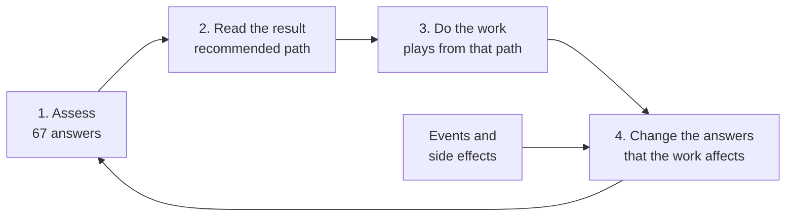

# Synthetic Users: Running Example Companies Through the AI Readiness Assessment

**How to simulate a company's journey from very low readiness to AI-native operations, with one full worked example**

| | |
|---|---|
| **Version** | 1.0 |
| **Date** | 2026-10-28 |
| **Companion documents** | Executive Summary v1.0 · System Deep Dive v1.0 |
| **Code reference** | App code at commit `8aa65ff`. v1.0 documents at commit `33bfb95`. |
| **Runner script** | `assessment/docs/analysis/synthetic-journey.mjs` (no dependencies). Every score in this document comes from the real assessment code. |
| **Writing style** | Plain English, written to the rules of ASD-STE100 (Simplified Technical English): short sentences, active voice, one word for one meaning. |

---

## 1. Purpose

This document tells you how to run a **synthetic user** through the AI Readiness Assessment. A synthetic user is a made-up company with realistic answers.

You can use synthetic users to:

- show leaders how a company moves from Path 1 to Path 5 over time,
- train operators to read assessment results,
- test the framework when you change a weight, a threshold or a rule, and
- find gaps in the framework before real companies find them.

Section 7 gives one full example. **Northline Field Services** starts at a readiness index of 5 and reaches AI-native operations in 24 months, through 9 assessments.

---

## 2. Words used in this document

This document uses each word with one meaning only.

| Word | Meaning |
|---|---|
| **Synthetic user** | A made-up company that you run through the assessment. |
| **Assessment** | One complete set of answers, scored by the tool. |
| **Area** | One of the 8 diagnostic areas, for example Leadership or Data. The code calls these "sections". |
| **Question** | One of the 67 factor questions. Each question has an ID, for example `l1`. |
| **Answer** | Yes, No, or a number from 1 to 5. |
| **Area score** | The score of one area, from 1 (Weak) to 4 (Advanced). |
| **Index** | The overall readiness number, from 0 to 100. |
| **Path** | One of the 5 intervention paths. Path 1 is the first. Path 5 is the last. |
| **Play** | One piece of work that a path recommends. Each path has 6 plays. |
| **Deal-breaker** | A rule that caps the path when a key area is weak. The code calls these "gates". |
| **Step** | One assessment in a journey. In this document, "step" does not mean "path". |
| **Event** | Something outside the plan, for example a new CEO or an incident. |
| **Side effect** | An unplanned result of planned work. |

---

## 3. How the method works

The method is a loop. Each turn of the loop is one step.



Plain-text version:

```
  ┌───────────► 1. ASSESS (run all 67 answers through the tool)
  │                    │
  │                    ▼
  │             2. READ THE RESULT (area scores, index, path)
  │                    │
  │                    ▼
  │             3. DO THE WORK (plays from the recommended path)
  │                    │
  │                    ▼
  └──────────── 4. CHANGE THE ANSWERS (only answers that the work affects)
                       ▲
                       │
               EVENTS AND SIDE EFFECTS
```

The important rule is this: **the work must come from the path that the last assessment recommended.** The tool decides what the company does next, and the company does that work. The next assessment shows whether the work changed the answers. That makes each journey a test of the framework's own advice.

---

## 4. Procedure: run a synthetic user

Do these steps in sequence.

1. **Write a company profile.** Give the company a name, a type, a size and a business model. Write two to four sentences about its situation. Use one of the 4 company types in the tool.
2. **Write the baseline answers.** Give an answer to all 67 questions. For each answer, think of one fact that an operator could see. Example: for `d3` ("records exist on paper"), the fact is "technicians fill in paper job tickets".
3. **Run the baseline through the tool.** Record the 8 area scores, the index, the band, the raw path, the final path and the deal-breakers.
4. **Choose the work for the next period.** Select 3 to 8 plays from the recommended path. You can also select catch-up work from a lower path. Do not select work from a higher path.
5. **Write each piece of work as a fact.** Use one sentence. Include a number when you can. Example: "The team measured the baseline: 9.2 minutes to book an emergency job."
6. **Change only the answers that the work affects.** Use the work-to-answer map in Section 6. Do not change an answer without a cause.
7. **Apply the pace rules.** Use the pace guide in Section 5.3. A scale answer must not move more than 2 points in one period.
8. **Add events and side effects.** Use the event guide in Section 5.4. An answer can get worse only from an event or a side effect.
9. **Run the new answers through the tool.** Record the results.
10. **Do the checks in Section 5.5.** If a check fails, correct the journey and run it again.
11. **Repeat steps 4 to 10.** Stop when the company has been on Path 5 for two steps, or after 36 months.
12. **Write what each result means.** Use two to five short sentences per step. Say what changed, why the path is what it is, and what the company must do next.

**Note:** Use 3-month periods. One quarter is enough time for real work, and short enough to show the order in which things change.

---

## 5. Rules that keep a journey realistic

### 5.1 Work rules

| Rule | Reason |
|---|---|
| **W1. Do not skip ahead.** Work comes from the recommended path or from a lower path. | The framework says the paths are a sequence. A synthetic user that skips ahead does not test the framework. |
| **W2. Catch-up work is allowed.** A company can do work from a lower path at any time. | Real companies go back and finish foundation work. |
| **W3. Fix a deal-breaker first.** If a deal-breaker capped the last result, the company must fix that area first. After that, in the same period, work from the uncapped path can continue. | This is what the deal-breaker means. Other work does not stop, but the next step cannot start without the missing foundation. |
| **W4. Work on the unlock conditions is allowed.** Each path lists what must be true before the next path. Work on those conditions counts as work on the current path. | Example: Path 4 says "requires strong governance". Governance work during Path 4 is correct. |

### 5.2 Answer rules

| Rule | Reason |
|---|---|
| **A1. Every changed answer has a cause.** The cause is a piece of work, an event or a side effect. | This keeps the journey traceable, in the same way that the tool's logic trace is. |
| **A2. A scale answer moves 2 points or less per period.** | Maturity grows in stages. A jump of 3 points in one quarter is not realistic. |
| **A3. An answer gets worse only from an event or a side effect.** | Planned work does not make a company worse on purpose. If planned work lowers a score, record it as a side effect and explain it. |
| **A4. Answer all 67 questions at every step.** | Missing answers change results a lot (see Deep Dive §17). Keep them out of the journey, unless the journey tests missing answers on purpose. |

### 5.3 Pace guide

Different kinds of change take different amounts of time. Use this guide when you decide how much work fits in one period.

| Kind of question | Examples | Usual time to improve | Notes |
|---|---|---|---|
| **Decisions** | `l1` owner, `l4` priorities, `l5` business case, `g1` output owner, `g4` approval rule | 1 quarter | Decisions can also reverse in a few weeks. See the event guide. |
| **Process and documents** | `w1` maps, `w2` exceptions, `w5` workflow owner, `m1` baselines, `g3` failure plan | 1 to 2 quarters | Needs workshops and people's time, not new systems. |
| **Systems and data** | `d1` managed systems, `d3` paper, `d4` integrations, `d8` data access, `e5` cloud, `s4` action capability | 2 to 4 quarters | Needs engineering work. This is usually the slowest group. |
| **Skills and hiring** | `e1` ML talent, `e9` AI product skill | 2 to 3 quarters | Approving a hire makes `e4` ("planned but not hired") true first. The score goes down until the person starts. |
| **Trust and culture** | `u6` adoption risk, `u7` trust, `u8` change capacity, `l7` alignment | 2 to 4 quarters to improve | These can get worse in a few weeks, for example after a rumor or a bad incident. |
| **Maturity scales** | `g7`, `g8`, `e6`, `m6`, `s5` | +1 per quarter | +2 only with a focused project in that period. |

**Pace setting.** The example in Section 7 is **fast**. The company has a full-time owner, a budget, an investor that supports the work, and an outside operator. For most simulations, use a slower setting: about half the work per period, and one or two extra periods on Path 2.

### 5.4 Event guide

Events make a journey realistic. Without events, every journey is a straight line, and real journeys are not.

| Event | What it changes | Suggested setting for simulation |
|---|---|---|
| **The AI owner leaves** | `l1` → No, `l2` → Yes, `l7` −1 | Once in 24 months, for about 1 in 3 companies |
| **New CEO or strategy review** | `l5` → No while under review, `l8` −1 | Often occurs together with the event above |
| **Budget cut** | `e4` → Yes (hiring frozen), `l9` −1. Pause 1 to 2 plays. | Once in 24 months, for about 1 in 4 companies |
| **Key engineer leaves** | `e1` → No or `e8` −1 | Once in 24 months, for about 1 in 4 companies |
| **AI incident** (a wrong AI output reaches a customer) | With a failure plan: no change. Without a plan: `u7` −1, `u6` +1. | Once during Path 3 to 5 |
| **Fear of job loss** when a pilot starts | `u6` +1 (side effect) | At most pilot launches |
| **Acquisition of another company** | `d1` or `d4` worse (new systems), `w1` coverage down | Rare. Use it for stress tests. |
| **New regulation or contract terms** | `d10` → Yes | Rare. Use it for regulated industries. |

**Note:** These settings are simulation choices, not measured facts. Calibrate them when you have data from real assessments (Deep Dive §23).

### 5.5 Checks

The runner script does checks 1 to 3 automatically. Do checks 4 to 6 yourself.

1. **No skipping ahead** (rule W1, with the W3 exception).
2. **No scale answer moves more than 2 points** in one period (rule A2).
3. **No answer gets worse from planned work** (rule A3).
4. **Every piece of work is a fact that an operator could see.** If it is a feeling, rewrite it.
5. **The numbers in the work are consistent.** Example: if the baseline is 9.2 minutes, later results compare with 9.2.
6. **Each step's meaning agrees with the tool's result.** Do not write "the company is ready for pilots" if the tool says Path 2.

---

## 6. The work-to-answer map

This map connects each play to the questions it usually changes. It is the core of the method. Use it in step 6 of the procedure.

### Path 1: Educate and Align

| Play | Questions it usually changes |
|---|---|
| Leadership alignment workshop on AI strategy | `l7` +1 or +2, `l8` +1, `l3` → No |
| Define and prioritize top 3 workflows for AI targeting | `l4` → Yes |
| Clarify AI thesis and success metrics with executive team | `l9` +1. `l6` → Yes only when baselines exist (often during Path 2) |
| Map current AI landscape and initiatives | `l2` → No when separate efforts join together |
| Establish AI steering group or governance body | `l1` → Yes if one person is accountable, `g8` +1 |
| Document business case and investment rationale | `l5` → Yes, `m3` → No, `m7` +1 |

### Path 2: Diagnose Workflows and Instrument the Baseline

| Play | Questions it usually changes |
|---|---|
| Workflow mapping sprint across priority operational areas | `w1` → Yes, `w6` → Yes, `w7` → Yes, `w8` +1 or +2 |
| Queue and exception path audit | `w2` → Yes, `w3` → Yes, `w4` → Yes |
| Instrumentation gap assessment | `m6` +1 |
| Data architecture audit and accessibility review | `d9` → Yes. The fixes that follow change `d1`, `d2`, `d3`, `d4`, `d5` |
| Baseline metrics collection for target workflows | `m1` → Yes, `m6` +1 |
| Establish measurement framework and KPI definition | `m2` → Yes, `m5` → Yes, `l6` → Yes |
| *(Common with the plays above)* Name workflow owners | `w5` → Yes, `w9` +1 |

### Path 3: Launch Targeted Assistive Pilots

| Play | Questions it usually changes |
|---|---|
| Assistive AI pilot design and scoping | `s3` → Yes, `u1` → Yes, `u2` → No, `u5` → Yes |
| Human review pattern design and integration | `u3` → Yes, `g4` → Yes |
| Evaluation framework and rollout guardrails | `g5` → Yes, `g7` +1, `e8` +1 |
| Narrow workflow pilot selection and success criteria | `m4` → Yes when results show value, `m7` +1 |
| Feedback loop and iteration model design | `u4` → Yes, `u7` +1 |
| Change management plan for pilot cohort | `u8` +1. **Side effect:** `u6` often goes up by 1 when the pilot starts |

### Path 4: Redesign Workflow Around AI

| Play | Questions it usually changes |
|---|---|
| Core workflow redesign initiative with AI at the center | `w8` → 4 or 5, `s1` → No, `s5` +1 |
| Approvals and queue redesign around AI-assisted steps | `g4`, `g7` +1, `w3` → Yes |
| In-product operational UX redesign | `s6` +1, `s7` +1 |
| Change management and transition plan | `u7` +1, `u8` +1, `u6` −1 |
| Rollout sequencing and pilot expansion strategy | `e8` +1, `e9` +1 |
| Post-redesign measurement and optimization model | `m6` +1, `m7` +1 |
| *(Unlock work)* Governance and execution for Path 5 | `g2` → No, `g8` +1 or +2, `e6` +1, `e7` +1, `s4` → Yes |

### Path 5: Operationalize Bounded Action Systems

| Play | Questions it usually changes |
|---|---|
| Bounded action contract design with explicit scope and limits | `s4` → Yes, `g7` → 5 |
| Escalation and override model design | `g3`, `u3` stay Yes. This is evidence that they still work. |
| Governance operating model for autonomous AI actions | `g2` → No, `g8` → 5 |
| Action observability and monitoring model | `g5`, `m6` → 4 or 5, `e6` +1 |
| Operator review and audit protocol | `g1`, `g5` stay Yes |
| Progressive autonomy expansion framework | `s5` → 5, `s7` +1 |

---

## 7. Example journey: Northline Field Services

### 7.1 Company profile

*Northline Field Services is a fictional company. Any match to a real company is accidental.*

| | |
|---|---|
| **Company type** | Services + Software |
| **Business** | Northline sells scheduling and job-tracking software to about 1,400 heating, cooling and plumbing contractors. It also runs an after-hours call center that books emergency jobs for those contractors. |
| **Size** | 180 employees: 22 engineers, 38 dispatchers and call agents, and sales, support and finance teams. 140 field technicians work for its contractor customers and use its app. |
| **Owner** | A growth investor owns a majority stake. |
| **Trigger** | A competitor announced an "AI dispatcher". The investor asked for an AI plan. |
| **Starting point** | Nobody owns AI. Dispatch knowledge is in four people's heads. Bookings are in spreadsheets. Job tickets are on paper. |
| **End point** | The AI books and dispatches routine jobs alone, inside written limits, with a person for every exception. |

### 7.2 The journey at a glance

Area scores: 1 = Weak, 2 = Partial, 3 = Strong, 4 = Advanced.

| Step | Month | Leadership | Workflows | Data | People & Trust | Technical Ability | Oversight | Measurement | Storing → Doing | Index | Band | Path |
|---|---|---|---|---|---|---|---|---|---|---|---|---|
| 1 | 0 | 1 | 1 | 1 | 1 | 2 | 1 | 1 | 1 | 5 | Low | **1** |
| 2 | 3 | 3 | 1 | 1 | 1 | 2 | 1 | 1 | 1 | 15 | Low | **2** |
| 3 | 6 | 3 | 3 | 2 | 1 | 2 | 1 | 3 | 1 | 37 | Low | **2** |
| 4 | 9 | 4 | 3 | 3 | 1 | 2 | 1 | 3 | 1 | 47 | Developing | **3** |
| 5 | 12 | 4 | 3 | 4 | 3 | 3 | 3 | 4 | 2 | 77 | Strong | **4** |
| 6 | 15 | 2 | 3 | 4 | 4 | 3 | 3 | 4 | 2 | 70 | Strong | **1** (capped from 4) |
| 7 | 18 | 4 | 3 | 4 | 4 | 4 | 3 | 4 | 3 | 88 | Advanced | **4** |
| 8 | 21 | 4 | 3 | 4 | 4 | 4 | 4 | 4 | 4 | 95 | Advanced | **5** |
| 9 | 24 | 4 | 4 | 4 | 4 | 4 | 4 | 4 | 4 | 100 | Advanced | **5** |

```
Readiness index (0-100), by month
Month  0  ██                                         5  Path 1
Month  3  ██████                                    15  Path 2
Month  6  ███████████████                           37  Path 2
Month  9  ███████████████████                       47  Path 3
Month 12  ███████████████████████████████           77  Path 4
Month 15  ████████████████████████████              70  Path 1 (capped)
Month 18  ███████████████████████████████████       88  Path 4
Month 21  ██████████████████████████████████████    95  Path 5
Month 24  ████████████████████████████████████████ 100  Path 5
```

### 7.3 Step by step

#### Step 1: Month 0. The first assessment

**Situation.** The investor asks for an AI plan. The CEO asks an outside operator to assess the company. Three teams test a public chat tool on their own. Nobody owns AI. Four senior dispatchers know how dispatch works. Nothing is written down. Call agents type bookings into shared spreadsheets. Technicians fill in paper job tickets.

**Assessment result.**

| Leadership | Workflows | Data | People & Trust | Technical Ability | Oversight | Measurement | Storing → Doing | Index | Path |
|---|---|---|---|---|---|---|---|---|---|
| 1 | 1 | 1 | 1 | 2 | 1 | 1 | 1 | 5 | **1** |

Band: **Low Readiness**. Deal-breakers triggered: `gate_leadership`, `gate_workflow_data`, `gate_governance`, `gate_execution`. Deal-breakers that changed the result: none. Recommended: **Path 1: Educate and Align**.

**What the result means.** Every area is weak except Technical Ability. That area is Partial, because the company has good software engineers and does not depend on outside vendors. The index is 5. All four deal-breakers are on. The tool recommends Path 1: align leadership before any technical work.

**Next actions in the report** *(quoted from the path library)*:

1. Facilitate executive alignment session to define AI thesis and owner
2. Map and prioritize top workflow candidates for AI value
3. Draft success criteria before any technical scoping begins
4. Assess current AI experiments and consolidate under a single strategy

#### Step 2: Month 3. Leadership agrees on why, who and what

**Situation.** The company starts Path 1. The leadership team has a two-day workshop with the operator.

**Work done since the last assessment.**

- The CEO named the COO as the executive owner of AI. *(Path 1 play)*
- The team stopped the three separate chat-tool tests and put them under one steering group that meets every month. *(Path 1 play)*
- Leadership chose three priority workflows: after-hours emergency booking, daily dispatch scheduling, and unpaid-invoice follow-up. *(Path 1 play)*
- The COO wrote a four-page business case and presented it at the all-hands meeting. *(Path 1 play)*
- Leadership drafted success targets, for example "book an emergency job in under 5 minutes". Finance did not accept the targets yet, because nobody had measured the current numbers. *(Path 1 play)*
- The steering group published a one-page AI use policy: no customer data goes into public chat tools. *(Path 1 play)*

**Answers that changed.**

| Question | Area | Before | After |
|---|---|---|---|
| `l1` Clear executive owner exists for AI strategy | Leadership | No | Yes |
| `l2` AI ownership is distributed with no single accountable lead | Leadership | Yes | No |
| `l3` AI interest is primarily market-pressure driven | Leadership | Yes | No |
| `l7` Executive alignment on AI direction | Leadership | 1 | 3 |
| `l4` Priority workflows are explicitly defined | Leadership | No | Yes |
| `l5` Business case for AI is explicit and socialized | Leadership | No | Yes |
| `l9` Maturity of AI investment thesis | Leadership | 1 | 3 |
| `m3` Expected value from AI is still vague | Measurement | Yes | No |
| `m7` Value capture clarity | Measurement | 1 | 2 |
| `l8` Cross-functional teams understand AI priorities | Leadership | 1 | 2 |
| `g8` Overall governance maturity | Oversight | 1 | 2 |

**Assessment result.**

| Leadership | Workflows | Data | People & Trust | Technical Ability | Oversight | Measurement | Storing → Doing | Index | Path |
|---|---|---|---|---|---|---|---|---|---|
| **3** ▲ | 1 | 1 | 1 | 2 | 1 | 1 | 1 | 15 ▲ | **2** |

Band: **Low Readiness**. Deal-breakers triggered: `gate_workflow_data`, `gate_governance`, `gate_execution`. Deal-breakers that changed the result: none. Recommended: **Path 2: Diagnose Workflows and Instrument the Baseline**.

**What the result means.** Leadership is now Strong. Nothing else changed much, so the index is only 15. This is normal. Path 1 work is decisions, and decisions do not change workflows or data. The path moves to 2, because Workflows and Data are still weak.

**Next actions in the report** *(quoted from the path library)*:

1. Run structured workflow mapping workshops for the top 2-3 priority workflows
2. Audit data availability and quality for those workflows
3. Instrument baseline performance metrics before any AI build
4. Document exceptions, handoffs, and workaround patterns

#### Step 3: Month 6. The company maps its work and finds its data

**Situation.** The company starts Path 2. The operator runs mapping workshops with dispatchers, call agents and the billing team.

**Work done since the last assessment.**

- Dispatchers and call agents mapped the three priority workflows on a wall with sticky notes. An analyst drew the final maps in a diagram tool. *(Path 2 play)*
- The workshops found 11 types of exception, for example "no heat, tenant calls but landlord pays" and "technician sick, job must move". *(Path 2 play)*
- The CEO named the Dispatch Operations Lead as the owner of the dispatch and after-hours booking workflows. *(Path 2 play)*
- A data audit found three different "sources of truth" for bookings. Call agents now enter bookings in the product booking form, not in spreadsheets. *(Path 2 play)*
- The team measured the baseline. Booking an emergency job took 9.2 minutes. Agents missed 18% of after-hours calls. Technicians fixed 71% of jobs on the first visit. *(Path 2 play)*
- A weekly KPI review now tracks these numbers on a dashboard. *(Path 2 play)*
- The engineering team added an automated build and test pipeline before the cloud move. *(Path 2 play)*

**Events and side effects.**

- **Side effect:** Dispatchers took part in the workshops. Their fear of replacement went down.

**Answers that changed.**

| Question | Area | Before | After |
|---|---|---|---|
| `w1` Workflow maps or documentation exist | Workflows | No | Yes |
| `w6` Teams discuss workflows, not just features | Workflows | No | Yes |
| `w7` Workflow scope is well understood for AI targeting | Workflows | No | Yes |
| `w8` Workflow visibility | Workflows | 1 | 3 |
| `w2` Exception paths and edge cases are understood | Workflows | No | Yes |
| `w5` Workflow has a named operational owner | Workflows | No | Yes |
| `w9` Operational ownership clarity | Workflows | 2 | 3 |
| `d1` Critical records live in managed systems | Data | No | Yes |
| `d2` Core data is heavily spreadsheet-dependent | Data | Yes | No |
| `d5` Record completeness | Data | 2 | 3 |
| `d6` Data freshness and update reliability | Data | 2 | 3 |
| `d9` Data governance and ownership is defined | Data | No | Yes |
| `m1` Baseline metrics for key workflows exist | Measurement | No | Yes |
| `m6` Instrumentation quality | Measurement | 2 | 3 |
| `m2` Workflow KPIs are defined and tracked | Measurement | No | Yes |
| `m5` Measurement and instrumentation is in place | Measurement | No | Yes |
| `e6` DevOps strength | Technical Ability | 2 | 3 |
| `u6` Adoption risk | People & Trust | 5 | 4 |
| `u7` Trust readiness of user population | People & Trust | 1 | 2 |

**Assessment result.**

| Leadership | Workflows | Data | People & Trust | Technical Ability | Oversight | Measurement | Storing → Doing | Index | Path |
|---|---|---|---|---|---|---|---|---|---|
| 3 | **3** ▲ | **2** ▲ | 1 | 2 | 1 | **3** ▲ | 1 | 37 ▲ | **2** |

Band: **Low Readiness**. Deal-breakers triggered: `gate_governance`, `gate_execution`. Deal-breakers that changed the result: none. Recommended: **Path 2: Diagnose Workflows and Instrument the Baseline**.

**What the result means.** Workflows and Measurement are now Strong. Data is Partial, because many technicians still use paper tickets. The index more than doubled, from 15 to 37, but the path stays at 2. The tool says: finish the data work before any AI pilot.

**Next actions in the report** *(quoted from the path library)*:

1. Run structured workflow mapping workshops for the top 2-3 priority workflows
2. Audit data availability and quality for those workflows
3. Instrument baseline performance metrics before any AI build
4. Document exceptions, handoffs, and workaround patterns

#### Step 4: Month 9. Paper goes away and the targets become official

**Situation.** Path 2 continues. Data is still the weakest foundation, so the company stays on data work.

**Work done since the last assessment.**

- All 140 technicians moved to the mobile app. The company stopped paper job tickets and scanned two years of old tickets. *(Path 2 play)*
- Engineers connected the product database to the accounting system, so invoices and jobs now match automatically. *(Path 2 play)*
- The booking form now requires address, equipment type and urgency. *(Path 2 play)*
- An analyst started to tag two years of job records with fault codes. *(Path 2 play)*
- Finance accepted the success targets, because the baseline now exists. *(Path 2 play)*
- The product moved to a cloud platform. *(Path 2 unlock work)*
- The board approved a budget to hire a machine-learning engineer. *(Path 2 unlock work)*
- The company gave one support manager the job of change lead for AI work. *(Path 2 unlock work)*

**Events and side effects.**

- **Side effect:** The new dashboards showed agents where calls were lost. Trust in the program went up.
- **Side effect:** The open job for a machine-learning engineer makes the question "AI talent is planned but not yet hired" true. The Technical Ability score goes down a little until the person starts.

**Answers that changed.**

| Question | Area | Before | After |
|---|---|---|---|
| `d3` Critical records still exist in paper or undigitized form | Data | Yes | No |
| `d4` Integration coverage between systems is strong | Data | No | Yes |
| `d5` Record completeness | Data | 3 | 4 |
| `d7` Data labeling or annotation coverage | Data | 1 | 2 |
| `l6` AI success metrics are defined and agreed upon | Leadership | No | Yes |
| `l8` Cross-functional teams understand AI priorities | Leadership | 2 | 3 |
| `e5` Cloud-native platform exists | Technical Ability | No | Yes |
| `e7` Platform readiness for AI integration | Technical Ability | 1 | 2 |
| `u8` Change management capacity in the organization | People & Trust | 2 | 3 |
| `u6` Adoption risk | People & Trust | 4 | 3 |
| `e4` AI talent is planned but not yet hired | Technical Ability | No | Yes |

**Assessment result.**

| Leadership | Workflows | Data | People & Trust | Technical Ability | Oversight | Measurement | Storing → Doing | Index | Path |
|---|---|---|---|---|---|---|---|---|---|
| **4** ▲ | 3 | **3** ▲ | 1 | 2 | 1 | 3 | 1 | 47 ▲ | **3** |

Band: **Developing Readiness**. Deal-breakers triggered: `gate_governance`, `gate_execution`. Deal-breakers that changed the result: none. Recommended: **Path 3: Launch Targeted Assistive Pilots**.

**What the result means.** Data is now Strong. Leadership is Advanced, because finance accepted the targets. The path moves to 3. Technical Ability and Oversight are still weak, so the tool allows a supervised pilot, but not a redesign.

**Next actions in the report** *(quoted from the path library)*:

1. Scope a bounded pilot in one priority workflow with defined success criteria
2. Design human review and override mechanisms before launch
3. Build evaluation framework to assess pilot output quality
4. Instrument the pilot for performance tracking from day one

#### Step 5: Month 12. The first AI pilot goes live, with a human check

**Situation.** The company starts Path 3. It picks one workflow for a pilot: after-hours emergency booking.

**Work done since the last assessment.**

- The team built an AI booking assistant inside the booking screen. It writes a draft booking from the call recording. *(Path 3 play)*
- The call agent checks and confirms every draft. The AI cannot book a job alone. *(Path 3 play)*
- Each field in the draft shows the part of the call it came from. *(Path 3 play)*
- QA staff check 200 random drafts each week. Accuracy went from 88% to 95% in 10 weeks. *(Path 3 play)*
- The Head of Support QA owns AI output quality. A written plan says what to do when a draft is wrong: call the customer back within 15 minutes and log the incident. *(Path 3 play)*
- Results after one quarter: 5.4 minutes to book (was 9.2) and 10% of calls missed (was 18%). *(Path 3 play)*
- The company hired a senior machine-learning engineer. The team uses an outside speech-to-text service but builds the assistant itself. *(Path 3 unlock work)*
- Analysts can now query job data in a cloud data warehouse. *(Path 3 unlock work)*

**Events and side effects.**

- **Side effect:** When the pilot started, a rumor said AI would replace call agents. Adoption risk went up for a short time.

**Answers that changed.**

| Question | Area | Before | After |
|---|---|---|---|
| `u1` AI can be delivered inside the user's workflow context | People & Trust | No | Yes |
| `u2` AI is currently treated like a sidebar or add-on feature | People & Trust | Yes | No |
| `u5` Users have prior experience with AI-assisted tools | People & Trust | No | Yes |
| `s3` Assistive AI is technically and contextually realistic | Storing → Doing | No | Yes |
| `s5` SoR to SoA progression stage | Storing → Doing | 1 | 2 |
| `u3` Users can review, override, or correct AI outputs | People & Trust | No | Yes |
| `g4` Approval logic for AI actions is defined | Oversight | No | Yes |
| `u4` AI output explainability can be surfaced to users | People & Trust | No | Yes |
| `g5` AI outputs are auditable | Oversight | No | Yes |
| `g7` Approval logic maturity | Oversight | 1 | 3 |
| `e8` AI delivery confidence | Technical Ability | 2 | 3 |
| `g1` Clear owner exists for AI output quality | Oversight | No | Yes |
| `g3` Failure response is defined | Oversight | No | Yes |
| `g6` Risk assessment for AI use cases has been completed | Oversight | No | Yes |
| `g8` Overall governance maturity | Oversight | 2 | 3 |
| `m4` An economic model for AI value exists | Measurement | No | Yes |
| `m7` Value capture clarity | Measurement | 2 | 3 |
| `e1` Senior ML or AI engineering capability exists in-house | Technical Ability | No | Yes |
| `e4` AI talent is planned but not yet hired | Technical Ability | Yes | No |
| `e7` Platform readiness for AI integration | Technical Ability | 2 | 3 |
| `d8` Data is accessible to AI/ML tooling without significant engineering work | Data | No | Yes |
| `u6` Adoption risk | People & Trust | 3 | 4 |

**Assessment result.**

| Leadership | Workflows | Data | People & Trust | Technical Ability | Oversight | Measurement | Storing → Doing | Index | Path |
|---|---|---|---|---|---|---|---|---|---|
| 4 | 3 | **4** ▲ | **3** ▲ | **3** ▲ | **3** ▲ | **4** ▲ | **2** ▲ | 77 ▲ | **4** |

Band: **Strong Readiness**. Deal-breakers triggered: none. Deal-breakers that changed the result: none. Recommended: **Path 4: Redesign Workflow Around AI**.

**What the result means.** Six areas went up in one quarter. A real pilot makes a company build oversight, measurement, technical skill and user trust at the same time. The index jumped from 47 to 77. The path moves to 4. Storing → Doing is still Partial: the product can suggest, but it cannot act yet.

**Next actions in the report** *(quoted from the path library)*:

1. Map the full workflow redesign from current state to AI-native target state
2. Define approval and override model for the redesigned workflow
3. Begin UX redesign for operational roles most affected
4. Stand up change management program for the transition

#### Step 6: Month 15. A setback: new CEO, no AI owner

**Situation.** The company starts Path 4 in month 13. It begins to redesign daily dispatch around AI. In month 14, the board appoints a new CEO. Two weeks later, the COO who owned AI leaves the company.

**Work done since the last assessment.**

- Before the change, dispatchers and designers held three workshops for the new dispatch process. The design is ready but not built. *(Path 4 play)*

**Events and side effects.**

- **Event:** The AI owner left. The CTO and the VP of Support both now claim the AI roadmap.
- **Event:** The new CEO paused the business case for review. The steering group stopped meeting.
- **Side effect:** The booking pilot kept running. Agents now like it, so adoption risk went down.

**Answers that changed.**

| Question | Area | Before | After |
|---|---|---|---|
| `w8` Workflow visibility | Workflows | 3 | 4 |
| `l1` Clear executive owner exists for AI strategy | Leadership | Yes | No |
| `l2` AI ownership is distributed with no single accountable lead | Leadership | No | Yes |
| `l7` Executive alignment on AI direction | Leadership | 3 | 2 |
| `l5` Business case for AI is explicit and socialized | Leadership | Yes | No |
| `l8` Cross-functional teams understand AI priorities | Leadership | 3 | 2 |
| `u6` Adoption risk | People & Trust | 4 | 2 |
| `u7` Trust readiness of user population | People & Trust | 2 | 3 |

**Assessment result.**

| Leadership | Workflows | Data | People & Trust | Technical Ability | Oversight | Measurement | Storing → Doing | Index | Path |
|---|---|---|---|---|---|---|---|---|---|
| **2** ▼ | 3 | 4 | **4** ▲ | 3 | 3 | 4 | 2 | 70 ▼ | **1** (capped from 4) |

Band: **Strong Readiness**. Deal-breakers triggered: `gate_leadership`. Deal-breakers that changed the result: `gate_leadership`. Recommended: **Path 1: Educate and Align**.

**What the result means.** Leadership fell from Advanced to Partial. The leadership deal-breaker now caps the result at Path 1, but the area scores alone point to Path 4. The index is 70 (Strong), but the recommendation is Path 1. The tool does not say the work was wrong. It says that nobody can lead the next step.

**Next actions in the report** *(quoted from the path library)*:

1. Facilitate executive alignment session to define AI thesis and owner
2. Map and prioritize top workflow candidates for AI value
3. Draft success criteria before any technical scoping begins
4. Assess current AI experiments and consolidate under a single strategy

#### Step 7: Month 18. Leadership recovers and the dispatch redesign goes live

**Situation.** The company does short Path 1 work first. It goes fast, because the business case and targets already exist. After the new owner starts, the dispatch redesign from Path 4 continues.

**Work done since the last assessment.**

- The new CEO reviewed the AI program for six weeks and kept it. The CEO named the VP of Operations as the executive owner. The annual plan now has a budget line for AI. *(Path 1 play)*
- The new dispatch process went live: the AI proposes the next-day schedule for routine maintenance jobs. Dispatchers approve the schedule and handle exceptions only. *(Path 4 play)*
- The company digitized the skills of all 140 technicians, so the AI can match each job to a qualified technician. *(Path 4 play)*
- All 38 dispatchers and call agents completed training. Two senior dispatchers became "exception dispatchers". *(Path 4 play)*
- The new CEO told staff in writing that AI savings will not cause layoffs in the call center. *(Path 4 play)*
- Results: daily schedule planning takes 1 hour (was 3.5 hours). First-visit fixes rose to 78% (was 71%). *(Path 4 play)*

**Answers that changed.**

| Question | Area | Before | After |
|---|---|---|---|
| `l1` Clear executive owner exists for AI strategy | Leadership | No | Yes |
| `l2` AI ownership is distributed with no single accountable lead | Leadership | Yes | No |
| `l5` Business case for AI is explicit and socialized | Leadership | No | Yes |
| `l7` Executive alignment on AI direction | Leadership | 2 | 4 |
| `l8` Cross-functional teams understand AI priorities | Leadership | 2 | 3 |
| `l9` Maturity of AI investment thesis | Leadership | 3 | 4 |
| `s1` Product is still predominantly a system of record | Storing → Doing | Yes | No |
| `s5` SoR to SoA progression stage | Storing → Doing | 2 | 3 |
| `s6` Product architecture supports AI action pathways | Storing → Doing | 1 | 3 |
| `s7` User expectation for AI action vs. AI assist | Storing → Doing | 1 | 2 |
| `d7` Data labeling or annotation coverage | Data | 2 | 3 |
| `u7` Trust readiness of user population | People & Trust | 3 | 4 |
| `u8` Change management capacity in the organization | People & Trust | 3 | 4 |
| `u6` Adoption risk | People & Trust | 2 | 2 |
| `e9` Product management sophistication for AI | Technical Ability | 1 | 3 |

**Assessment result.**

| Leadership | Workflows | Data | People & Trust | Technical Ability | Oversight | Measurement | Storing → Doing | Index | Path |
|---|---|---|---|---|---|---|---|---|---|
| **4** ▲ | 3 | 4 | 4 | **4** ▲ | 3 | 4 | **3** ▲ | 88 ▲ | **4** |

Band: **Advanced Readiness**. Deal-breakers triggered: none. Deal-breakers that changed the result: none. Recommended: **Path 4: Redesign Workflow Around AI**.

**What the result means.** Leadership recovered in one quarter, because the business case and the targets survived the change of CEO. Technical Ability went to Advanced and Storing → Doing went to Strong. The index is 88 (Advanced), but the path stays at 4. Oversight is 3, and Path 5 needs Oversight at 4.

**Next actions in the report** *(quoted from the path library)*:

1. Map the full workflow redesign from current state to AI-native target state
2. Define approval and override model for the redesigned workflow
3. Begin UX redesign for operational roles most affected
4. Stand up change management program for the transition

#### Step 8: Month 21. Oversight becomes a system, not a few careful people

**Situation.** Path 4 continues. The last barrier to Path 5 is oversight: it must be highly reliable before the AI acts alone.

**Work done since the last assessment.**

- The company set up a monthly AI review board with operations, legal, support QA and engineering. *(Path 4 unlock work)*
- The review board wrote approval rules for every AI action: what the AI can do alone, what needs a person, and who approves exceptions. *(Path 4 unlock work)*
- Engineers built monitoring for the AI: error rates, model versions and an automatic alert when accuracy drops. *(Path 4 unlock work)*
- The product can now update schedules and send customer text confirmations directly, with a full log of each change. *(Path 4 unlock work)*

**Events and side effects.**

- **Event:** During a January snowstorm, a calendar sync error made the AI double-book 9 technicians. Dispatchers went back to manual in 20 minutes. Engineers fixed the cause in 2 days and added a new rule. The failure plan worked.

**Answers that changed.**

| Question | Area | Before | After |
|---|---|---|---|
| `g2` Governance is informal or person-dependent | Oversight | Yes | No |
| `g8` Overall governance maturity | Oversight | 3 | 4 |
| `g7` Approval logic maturity | Oversight | 3 | 5 |
| `e6` DevOps strength | Technical Ability | 3 | 4 |
| `e7` Platform readiness for AI integration | Technical Ability | 3 | 4 |
| `e8` AI delivery confidence | Technical Ability | 3 | 4 |
| `s4` Bounded action execution is architecturally possible | Storing → Doing | No | Yes |
| `s5` SoR to SoA progression stage | Storing → Doing | 3 | 4 |
| `s6` Product architecture supports AI action pathways | Storing → Doing | 3 | 4 |
| `s7` User expectation for AI action vs. AI assist | Storing → Doing | 2 | 3 |

**Assessment result.**

| Leadership | Workflows | Data | People & Trust | Technical Ability | Oversight | Measurement | Storing → Doing | Index | Path |
|---|---|---|---|---|---|---|---|---|---|
| 4 | 3 | 4 | 4 | 4 | **4** ▲ | 4 | **4** ▲ | 95 ▲ | **5** |

Band: **Advanced Readiness**. Deal-breakers triggered: none. Deal-breakers that changed the result: none. Recommended: **Path 5: Operationalize Bounded Action Systems**.

**What the result means.** Oversight is now Advanced, because it no longer depends on a few careful people. Storing → Doing is Advanced, because the product can act. All Path 5 conditions are true. The snowstorm incident did not lower any score. The failure plan worked as written.

**Next actions in the report** *(quoted from the path library)*:

1. Define the initial bounded action scope with explicit limits and guardrails
2. Design escalation and human override pathways for out-of-bound cases
3. Establish full observability before any autonomous action goes live
4. Draft governance operating model and audit protocol

#### Step 9: Month 24. AI-native operations: the AI acts, within limits

**Situation.** The company starts Path 5. The AI now books and dispatches some jobs with no person in the loop, inside written limits.

**Work done since the last assessment.**

- The AI now books routine maintenance visits alone, but only inside five written limits. The customer has a service contract. The job takes less than 2 hours. The cost is less than $400. The job is not gas or electrical safety work. The customer confirms by text. *(Path 5 play)*
- Any job outside these limits goes to a person. The AI pauses itself if its error rate is over 2% on any day. *(Path 5 play)*
- QA staff audit a 5% sample of AI actions every week. A live dashboard shows every action the AI takes. *(Path 5 play)*
- Results: the AI books 62% of routine maintenance jobs with no human touch. Only 3% of after-hours calls are missed (was 18%). Six call agents moved into customer success roles. *(Path 5 play)*
- Catch-up work: the team mapped the third priority workflow, unpaid-invoice follow-up, and listed the last manual workarounds. One board now shows every queue in all three workflows. *(Path 4 play)*
- Northline started to sell the AI dispatcher to its own contractor customers. 210 contractors bought it in the first quarter. *(Path 5 play)*

**Answers that changed.**

| Question | Area | Before | After |
|---|---|---|---|
| `s7` User expectation for AI action vs. AI assist | Storing → Doing | 3 | 4 |
| `m6` Instrumentation quality | Measurement | 3 | 4 |
| `e9` Product management sophistication for AI | Technical Ability | 3 | 4 |
| `w3` Queues and handoffs between steps are visible | Workflows | No | Yes |
| `w4` Manual workarounds are known and catalogued | Workflows | No | Yes |
| `u5` Users have prior experience with AI-assisted tools | People & Trust | Yes | Yes |

**Assessment result.**

| Leadership | Workflows | Data | People & Trust | Technical Ability | Oversight | Measurement | Storing → Doing | Index | Path |
|---|---|---|---|---|---|---|---|---|---|
| 4 | **4** ▲ | 4 | 4 | 4 | 4 | 4 | 4 | 100 ▲ | **5** |

Band: **Advanced Readiness**. Deal-breakers triggered: none. Deal-breakers that changed the result: none. Recommended: **Path 5: Operationalize Bounded Action Systems**.

**What the result means.** All eight areas are Advanced. The index is 100, the maximum. The path stays at 5. The score cannot go higher, so the work changes. The company now widens the AI's limits one step at a time and checks each step.

**Next actions in the report** *(quoted from the path library)*:

1. Define the initial bounded action scope with explicit limits and guardrails
2. Design escalation and human override pathways for out-of-bound cases
3. Establish full observability before any autonomous action goes live
4. Draft governance operating model and audit protocol


---

## 8. What the journey shows

These patterns come from the scores above. They are typical of the rules in the framework, so you will see them in most journeys.

**1. Decisions move first. Systems move last.**
Leadership went from 1 to 3 in one quarter, because Path 1 work is decisions. Data took 12 months to go from 1 to 4, because it needed engineering work. Storing → Doing moved last (months 12 to 21), because the product itself had to change.

**2. Path 2 is where a company waits longest.**
Northline stayed on Path 2 for two steps (6 months). The cause was data: paper tickets and spreadsheets. In slower journeys, Path 2 often lasts a year or more.

**3. The index moves even when the path does not.**
From month 3 to month 6, the index went from 15 to 37, but the path stayed at 2. Show the index to teams in this phase. It tells them that the work is real, even when the recommendation does not change.

**4. Measurement must come before a pilot.**
The baseline at month 6 (9.2 minutes, 18% missed calls) let the pilot at month 12 prove its value (5.4 minutes, 10%). Without the baseline, the pilot has no proof.

**5. One pilot raises many areas at the same time.**
At month 12, six areas went up in one quarter. A real pilot forces a company to build oversight, measurement, technical skill and user trust together.

**6. Planned work can lower a score for a short time.**
At month 9, the open job for a machine-learning engineer made "AI talent is planned but not yet hired" true. At month 12, the pilot launch made adoption risk go up. Both are realistic. Explain them to the company before the assessment, so the score does not surprise them.

**7. A setback hits leadership, and the deal-breaker catches it.**
At month 15, the index was 70 (Strong), but the path was 1. The deal-breaker did its job: the company had no one to lead the next step. Recovery took one quarter, because the business case and the targets survived the change of CEO. *Documents make a company resilient.*

**8. Oversight is the last barrier.**
At month 18, the index was 88 (Advanced), but the path stayed at 4. Path 5 needs Oversight at 4. At month 21, three Oversight answers changed. The most important was `g2`: oversight stopped depending on a few careful people. That answer alone moves Oversight from 3 to 4.

**9. Path 5 is not the end of the work.**
At month 24, the index is 100 and it cannot go higher. The work changes from "get ready" to "widen the limits with care".

**10. The index and the path disagree when it matters most.**
They disagree at month 15 (index Strong, Path 1) and at month 18 (index Advanced, Path 4). In both cases, the path is the correct guide. Explain this in every report.

---

## 9. What the journey found in the framework

A synthetic user is also a test of the framework. This journey found five gaps. Consider them for version 1.1.

| # | Finding | Where it shows | Suggestion |
|---|---|---|---|
| **J1** | **Approving a hire lowers the score.** Question `e4` ("AI talent is planned but not yet hired") becomes true when the company approves the hire. Technical Ability goes down until the person starts. | Step 4 (month 9) | Keep the question, because the gap is real. Add an operator note that tells the company to expect this. |
| **J2** | **No question measures a redesigned workflow.** Path 4's main output is a redesigned workflow, but the Workflows area did not go up from the redesign. It went up only when queue visibility and workaround lists came later. | Steps 6 to 9 | Add a question such as "A core workflow has been redesigned around AI, not only assisted". |
| **J3** | **No question rewards a failure plan that worked.** The snowstorm incident proved the failure plan, but no answer changed. Question `g3` asks only if a plan is defined. | Step 8 (month 21) | Add a question such as "The failure plan has been tested in a real incident or a drill". |
| **J4** | **The second visit to a path gets the same next actions as the first.** At month 15, the report gave the generic Path 1 actions, but the company needed only a new owner and a business-case review. | Step 6 (month 15) | Make next actions depend on which area caused the path (Deep Dive issue I-15). |
| **J5** | **The framework stops at Path 5.** At month 24, the index is at its maximum and the path cannot go higher. There is no guidance for what comes next. | Step 9 (month 24) | Add a "sustain and expand" stage, or Path 5 sub-levels for the size of the AI's limits. |

---

## 10. How to run many synthetic users

One hand-written journey shows the method. Many journeys test the framework. This section gives the design for a generator. The runner script already has the parts the generator needs: the engine call, the answer changes and the checks.

### 10.1 A grid of personas

Combine these four dimensions. The full grid has 4 × 4 × 3 × 3 = 144 journeys.

| Dimension | Values |
|---|---|
| **Company type** | B2B SaaS · Vertical Software · AI Native · Services + Software |
| **Starting profile** | Very low (like Northline) · Mixed · Strong technology but weak leadership · AI Native start-up with weak oversight |
| **Pace** | Fast (like Northline) · Normal (half the work per period) · Slow (one quarter of the work) |
| **Event profile** | Calm (no events) · Normal (the event guide settings) · Turbulent (double the event settings) |

### 10.2 The generator loop

```
for each persona in the grid:
    answers = baseline template for (company type, starting profile)
    for each quarter, up to 12 quarters:
        result = run the real engine on answers
        record result
        if result.path == 5 for 2 quarters: stop
        plays = select N plays from result.path and lower paths (N from the pace setting)
        apply each play's answer changes from the work-to-answer map
        apply pace limits (rule A2)
        draw events with the event guide probabilities and apply them
        apply side effects (for example, adoption risk +1 at a pilot launch)
        run the checks; if a check fails, correct the journey and run it again
```

Use a fixed random seed. Then the same grid always gives the same journeys, and you can compare runs before and after a change to the framework.

### 10.3 What to measure

| Measure | Question it answers |
|---|---|
| Months to reach each path | Is the framework's sequence realistic? Is Path 5 too hard or too easy to reach? |
| Months on each path | Where do companies stall? (Expect Path 2.) |
| How often each deal-breaker changes the result | Which foundations fail most often? |
| How often the index band and the path disagree | How often must operators explain the difference? |
| Results with deal-breakers on and off | How much do the deal-breakers change the advice? |
| Results with the 2–3 score line at 0.50 and at 0.60 | How sensitive are journeys to the most important threshold? |

### 10.4 Uses

- **Calibration.** If most normal-pace journeys never leave Path 2, the framework may be too strict.
- **Operator training.** Give operators a synthetic company and its answers. Ask them to predict the path before they run the tool.
- **Communication.** Show company leaders a journey that is like their own company, so they can see a realistic timeline.
- **Regression tests.** After any change to weights, thresholds or rules, run the grid again. Every changed journey must be a change that you expected.
- **The BERPL conversion.** Replace the company types, questions and plays with BERPL versions. Run the grid. Compare the journeys with this version.

---

## 11. Limits of synthetic users

- **A synthetic user shows what the rules do, not what real companies do.** It is a test of the framework's logic, not evidence that the framework is correct.
- **The author chooses the answers.** Authors like clean stories. Events and side effects help, but do not remove this bias.
- **The work-to-answer map, the pace guide and the event guide are judgment.** They are not calibrated against real data yet.
- **Real assessments have missing answers.** This journey answers all 67 questions at every step. Real journeys will be noisier.
- **This journey is fast.** It shows the shape of a journey, not a typical timeline.

---

## 12. Files and how to run again

| File | Purpose |
|---|---|
| `assessment/docs/analysis/synthetic-journey.mjs` | Defines the company profile, the baseline answers and every step. Runs them through the real engine. Does checks 1 to 3. |
| `assessment/docs/analysis/synthetic-journey-output-v1.0.txt` | Frozen output for version 1.0. Compare a new run with it after any change. |

```bash
node assessment/docs/analysis/synthetic-journey.mjs              # scores, normalized values and checks
node assessment/docs/analysis/synthetic-journey.mjs --markdown   # Section 7.2 and 7.3 of this document
```

To make a new synthetic user, copy the file. Change `COMPANY`, `BASELINE` and `STEPS`. Run it. The checks tell you if the journey breaks a realism rule.
